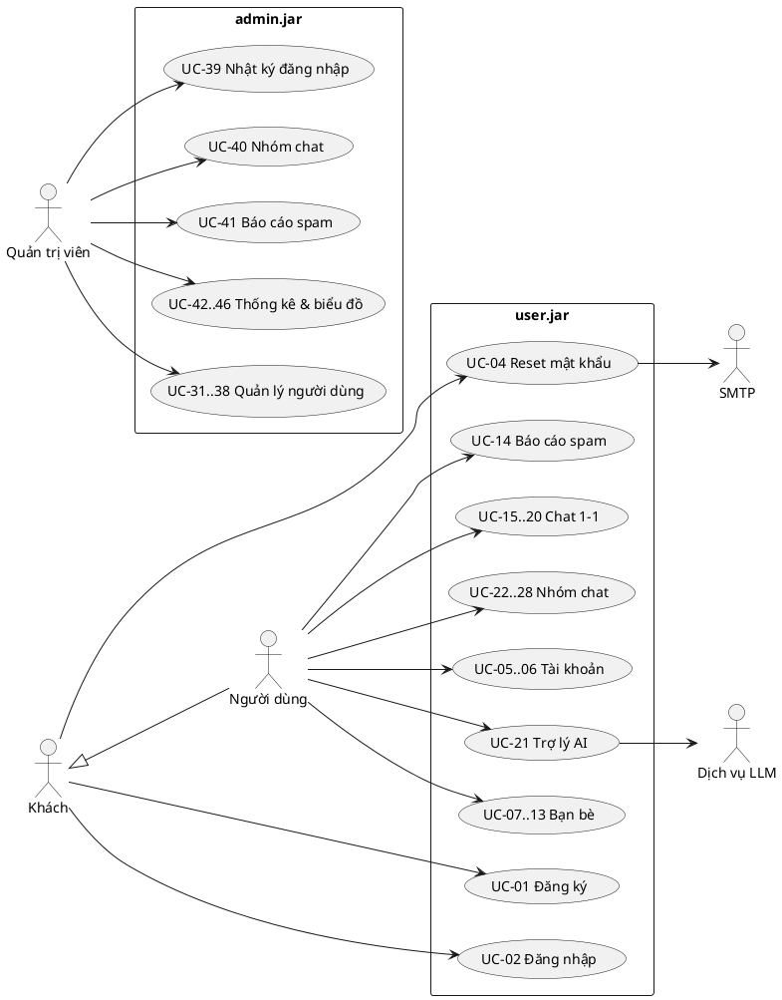

# ĐẶC TẢ USE CASE — HỆ THỐNG CHAT (Đồ án cuối kỳ Lập trình ứng dụng Java)

| Mục | Giá trị |
|---|---|
| Nguồn yêu cầu | `Final Project.pdf` (khách hàng), `YeuCau.txt` (ràng buộc kỹ thuật) |
| Phiên bản | 0.2 — đã chốt K1, K3, K4, K5 (08/11/2026); M7, M12, M15, M17, M18 chờ trả lời |
| Ngày lập | 08/11/2026 |
| Ký hiệu | `A1a` = mục 1.a phân hệ Quản trị · `U11f` = mục 11.f phân hệ Người dùng · `[ĐX]` = đề xuất của nhóm khi yêu cầu chưa rõ, cần khách hàng xác nhận |

---

## 1. PHÂN TÍCH YÊU CẦU — CÁC ĐIỂM KHÚC MẮC

### 1.1. Vấn đề chặn tiến độ (phải chốt trước khi code)

| # | Vấn đề | Chi tiết | Đề xuất |
|---|---|---|---|
| K1 | **Tech stack mâu thuẫn trong repo** | `README.md` ghi Frontend **React** + **MySQL**; `work-log.md` ghi **JavaFX + Spring Boot + PostgreSQL**. `YeuCau.txt` bắt buộc frontend là **Java** → React **không hợp lệ**. | **Đã chốt (08/11):** JavaFX 21 + FXML (có sẵn `BarChart` cho A6/A9) + **PostgreSQL**. README đã sửa. |
| K2 | **Bản mockup HTML không được tính là `src`** | Phiên bản 1 yêu cầu thư mục `src` chứa *mã nguồn các màn hình*. 15 file trong `design-ui/` là HTML, không phải mã Java. | Prototype chỉ dùng để duyệt UX; V1 phải nộp màn hình JavaFX (FXML + controller rỗng). |
| K3 | **Kiến trúc & số file jar** | Yêu cầu: ≥2 jar (quản lý, người dùng) + 1 file cấu hình *lưu thông tin kết nối CSDL*. Nhưng chat realtime cần một **socket server** → thực tế có 3 tiến trình. Câu hỏi: admin.jar nối thẳng CSDL (JDBC) hay đi qua server? | **Đã chốt (08/11):** 3 jar: `server.jar`, `user.jar`, `admin.jar` + 1 `config.properties` dùng chung. Mọi client đi qua server (socket thuần) → khóa tài khoản có thể ngắt kết nối user ngay lập tức; API key LLM và mật khẩu SMTP chỉ nằm ở server, không lộ trong `user.jar`. |
| K4 | **Mã hóa nhóm (U12g) xung đột với nhiều yêu cầu khác** | "Tham khảo Facebook" = mã hóa đầu-cuối (E2EE): server **không đọc được** nội dung. Hệ quả: (1) U3 reset mật khẩu ngẫu nhiên và A1d admin đặt mật khẩu → mất khóa riêng nếu khóa riêng được bảo vệ bằng mật khẩu; (2) U11g tìm kiếm phía server không tìm được tin mã hóa; (3) U11h gửi nội dung cho LLM bên ngoài phá vỡ E2EE; (4) admin không xem được nội dung (vốn không có yêu cầu xem → ổn). | **Đã chốt (08/11): phương án đơn giản** — server giữ khóa nhóm, tin nhắn được mã hóa khi lưu vào CSDL (xem UC-28). Vì server giải mã được nên reset mật khẩu, tìm kiếm và trợ lý AI hoạt động bình thường. Đổi lại đây **không phải** E2EE như Facebook: người có quyền trên server đọc được tin nhắn. |
| K5 | **Deadline mâu thuẫn** | `README.md`: V1 = 18/10/2026; `project_roadmap.md`: V1 = 22/11, V2 = 12/12. | **Đã chốt (08/11):** V1 = 22/11/2026, V2 = 12/12/2026. README đã sửa. |
| K6 | **Hai bộ luật AI khác nhau** | `.agent/rules/CLAUDE.md` (bản cũ) và `code/.agent/rules/rule.md` (bản mới, có thêm template). `rule.md` trỏ tới `docs/ai/templates/` nhưng thư mục thật là `docs/ai/_template/`. | Giữ 1 bản (`rule.md`), đổi tên thư mục cho khớp. |

### 1.2. Yêu cầu mơ hồ về nghiệp vụ (đã đề xuất mặc định)

| # | Yêu cầu | Chỗ mơ hồ | Đề xuất mặc định `[ĐX]` |
|---|---|---|---|
| M1 | A1a "lọc theo trạng thái" | Trạng thái nào? online/offline hay hoạt động/bị khóa? | 2 bộ lọc: **Tài khoản** (Hoạt động / Bị khóa) và **Kết nối** (Online / Offline). |
| M2 | A1b "Xoá" người dùng | Xóa cứng làm mất tin nhắn, báo cáo spam, thống kê A5–A9; nhóm có thể mất admin duy nhất. | **Xóa mềm**: không đăng nhập, ẩn khỏi tìm kiếm, tin nhắn cũ hiện "Người dùng đã bị xóa"; vẫn tính trong thống kê quá khứ. Nếu là admin duy nhất của nhóm → thành viên lâu năm nhất thành admin. |
| M3 | A1b "Thêm" người dùng | Ai đặt mật khẩu ban đầu? | Admin nhập mật khẩu ban đầu (hoặc bấm "Tạo ngẫu nhiên" và gửi email). |
| M4 | A1d "Cập nhật mật khẩu" | Admin gõ mật khẩu mới hay kích hoạt reset email? | Admin gõ mật khẩu mới; tùy chọn "Gửi mật khẩu mới qua email người dùng". |
| M5 | A2 / A1e "danh sách đăng nhập" | Có ghi lần đăng nhập thất bại? | Chỉ ghi **đăng nhập thành công** (= 1 lần "mở ứng dụng", dùng cho A8/A9). |
| M6 | A4 sau khi khóa tài khoản | Báo cáo có trạng thái không? | Báo cáo có trạng thái **Chờ xử lý / Đã khóa / Bỏ qua**. |
| M7 | A7 "1 cột tính luôn số lượng bạn của bạn" | 3 cách hiểu: (a) số bạn của bạn (cấp 2, không trùng); (b) tổng số bạn của từng người bạn (có trùng); (c) bạn trực tiếp + bạn cấp 2. | Chữ "tính luôn" → **(c)**: số người khác nhau trong phạm vi 2 bước, không tính chính mình. Ví dụ: A–B, A–C, B–D, C–D → A: trực tiếp 2, tính luôn bạn của bạn 3 (B, C, D). |
| M8 | A8 "người dùng hoạt động" | Thế nào là hoạt động? "Lọc theo số lượng hoạt động" là cột nào? | Hoạt động trong khoảng = có ≥1 lần mở app **hoặc** ≥1 tin nhắn gửi đi. Bộ lọc số lượng mặc định áp dụng cho **số lần mở ứng dụng**, có combobox chọn cột khác. |
| M9 | A9 "số lượng người có mở ứng dụng" | Đếm lượt hay đếm người? | Đếm **số người khác nhau** có ≥1 lần đăng nhập trong tháng. |
| M10 | "Sắp xếp theo tên" (A1a, A3a, A5a, A7a, A8a) | Tên = họ tên hay tên đăng nhập? Sắp theo họ hay theo tên riêng (kiểu Việt)? | Sắp theo **họ tên đầy đủ**, collation tiếng Việt, kèm chiều tăng/giảm. |
| M11 | U6b và U9 trùng nhau | U6b "tìm theo tên và yêu cầu kết bạn", U9 "tìm theo tên đăng nhập hoặc tên". | Gộp thành **một màn hình tìm người dùng** (UC-08). |
| M12 | U6d Block | Người bị chặn còn nhắn tin được không? Có bỏ chặn không? Người chặn có còn thấy họ? | Chặn = hủy kết bạn + hủy lời mời chờ + **cấm nhắn tin 1-1 hai chiều**. Người bị chặn không tìm thấy người chặn (U9). Có danh sách **Đã chặn** để bỏ chặn. Trong nhóm chung vẫn thấy tin của nhau. |
| M13 | U9 "có thể chat" với người lạ | Có cần là bạn mới chat được? | **Không cần** là bạn (nên mới cần U10 báo cáo spam). |
| M14 | U10 điều kiện báo cáo | "khi người đó chat với mình". Báo cáo trong nhóm? | Chỉ báo cáo trong **chat 1-1**, đối phương phải đã gửi ≥1 tin. Lý do (tùy chọn). Mỗi cặp chỉ có 1 báo cáo đang chờ. |
| M15 | U11d/U11e xóa lịch sử | Xóa phía mình hay cả hai phía? | **Chỉ phía mình** (người kia vẫn thấy). Áp dụng cho cả nhóm. |
| M16 | U11g "tìm với tất cả mọi người" | Có gồm tin nhóm? | Gồm chat 1-1 **và** chat nhóm (nhóm mã hóa: tìm ở client). |
| M17 | U11h LLM | Nhà cung cấp? "chỉnh" và "gợi ý" là gì? Gửi bao nhiêu ngữ cảnh? | 2 chức năng: **Chỉnh câu** (sửa chính tả/giọng văn cho bản nháp) và **Gợi ý trả lời** (3 câu, dựa trên ≤10 tin gần nhất). Không bao giờ tự gửi — người dùng phải chọn. API key ở server. |
| M18 | U12 quyền trong nhóm | Chỉ nói "xóa thành viên: chỉ admin". Đổi tên, thêm thành viên, gán admin thì ai? | Mọi thành viên: chat, đổi tên, thêm thành viên. Chỉ admin: gán/thu hồi admin, xóa thành viên. Nhóm luôn có ≥1 admin. |
| M19 | U12a "thêm tối thiểu 1 tên đăng nhập" | Thêm người lạ được không? Người đã chặn mình? | Thêm bất kỳ người dùng hoạt động nào, trừ người có quan hệ chặn với người tạo. Nhóm tạo ra có ≥2 thành viên. |
| M20 | Rời nhóm / giải tán nhóm | Không có trong yêu cầu. | **Không làm** (ngoài phạm vi), ghi vào "chức năng làm thêm" nếu còn thời gian. |
| M21 | U3 reset mật khẩu | Ai cũng có thể reset mật khẩu người khác nếu chỉ cần tên đăng nhập. | Yêu cầu nhập **tên đăng nhập + email khớp**. Mật khẩu ngẫu nhiên 10 ký tự; khuyến nghị đổi sau khi đăng nhập. |
| M22 | Tài khoản bị khóa đang online | Không nói. | Server ngắt kết nối ngay, client hiện thông báo "Tài khoản đã bị khóa". |
| M23 | U1 thông tin đăng ký | Trường nào bắt buộc? Email trùng? | Bắt buộc: tên đăng nhập, họ tên, email, mật khẩu. Tùy chọn: địa chỉ, ngày sinh, giới tính. Tên đăng nhập và email là duy nhất. Không xác minh email. |

### 1.3. Ràng buộc phi chức năng rút ra

| # | Ràng buộc | Nguồn |
|---|---|---|
| N1 | Giao diện là ứng dụng desktop Windows viết bằng Java | YeuCau.txt |
| N2 | Socket tự dựng bằng `java.net.Socket`/`ServerSocket`, **không WebSocket** | YeuCau.txt |
| N3 | Chạy được bằng jar, chỉ cần sửa file cấu hình | PDF — Phiên bản 2 |
| N4 | Có script tạo CSDL | PDF — Yêu cầu chung |
| N5 | Tin nhắn tới người đang online hiển thị realtime (< 1 giây trong mạng LAN) | U11a |
| N6 | Mật khẩu lưu dạng băm (BCrypt), không lưu bản rõ | Đề xuất bảo mật |
| N7 | Mỗi tính năng: `plan.md`, `<feature>.md`, `work-log.md`, 1 commit riêng | YeuCau.txt |

---

## 2. TÁC NHÂN

| Tác nhân | Mô tả |
|---|---|
| **Khách** | Người chưa đăng nhập vào `user.jar`. |
| **Người dùng** | Người đã đăng nhập `user.jar`. Trong nhóm chat có thể là *thành viên* hoặc *admin nhóm*. |
| **Quản trị viên** | Người đăng nhập `admin.jar` với tài khoản có vai trò ADMIN. |
| **Dịch vụ email (SMTP)** | Hệ thống ngoài gửi mật khẩu mới (U3, A1d). |
| **Dịch vụ LLM** | API mô hình ngôn ngữ bên ngoài (U11h), được server gọi. |

---

## 3. DANH SÁCH USE CASE

### 3.1. Phân hệ Người dùng (`user.jar`)

| ID | Use case | Tác nhân chính | Yêu cầu |
|---|---|---|---|
| UC-01 | Đăng ký tài khoản | Khách | U1 |
| UC-02 | Đăng nhập | Khách | U5 |
| UC-03 | Đăng xuất | Người dùng | *Bổ sung* (cần cho trạng thái online) |
| UC-04 | Khởi tạo lại mật khẩu qua email | Khách, SMTP | U3 |
| UC-05 | Cập nhật thông tin tài khoản | Người dùng | U2 |
| UC-06 | Đổi mật khẩu | Người dùng | U4 |
| UC-07 | Xem danh sách bạn bè | Người dùng | U6a |
| UC-08 | Tìm người dùng | Người dùng | U6b, U9 |
| UC-09 | Gửi yêu cầu kết bạn | Người dùng | U6b |
| UC-10 | Xem & xử lý lời mời kết bạn | Người dùng | U7a, U7b |
| UC-11 | Hủy kết bạn | Người dùng | U6c |
| UC-12 | Chặn / bỏ chặn người dùng | Người dùng | U6d |
| UC-13 | Xem bạn bè đang online | Người dùng | U8 |
| UC-14 | Báo cáo spam | Người dùng | U10 |
| UC-15 | Nhắn tin 1-1 | Người dùng | U11a, U11b |
| UC-16 | Xem lịch sử chat | Người dùng | U11c |
| UC-17 | Xóa toàn bộ lịch sử chat | Người dùng | U11d |
| UC-18 | Xóa tin nhắn đã chọn | Người dùng | U11e |
| UC-19 | Tìm trong một cuộc trò chuyện | Người dùng | U11f |
| UC-20 | Tìm trong tất cả cuộc trò chuyện | Người dùng | U11g |
| UC-21 | Dùng trợ lý AI khi soạn tin | Người dùng, LLM | U11h |
| UC-22 | Tạo nhóm chat | Người dùng | U12a, U8, U9 |
| UC-23 | Đổi tên nhóm | Thành viên nhóm | U12b |
| UC-24 | Thêm thành viên | Thành viên nhóm | U12c |
| UC-25 | Gán / thu hồi quyền admin nhóm | Admin nhóm | U12d |
| UC-26 | Xóa thành viên | Admin nhóm | U12e |
| UC-27 | Chat nhóm | Thành viên nhóm | U12f |
| UC-28 | Nhóm chat mã hóa | Người dùng | U12g |

### 3.2. Phân hệ Quản trị (`admin.jar`)

| ID | Use case | Yêu cầu |
|---|---|---|
| UC-30 | Đăng nhập quản trị | *Bổ sung* (bảo vệ admin.jar) |
| UC-31 | Xem, lọc, sắp xếp danh sách người dùng | A1a |
| UC-32 | Thêm người dùng | A1b |
| UC-33 | Cập nhật thông tin người dùng | A1b |
| UC-34 | Xóa người dùng | A1b |
| UC-35 | Khóa / mở khóa tài khoản | A1c, A4d |
| UC-36 | Đặt lại mật khẩu người dùng | A1d |
| UC-37 | Xem lịch sử đăng nhập của một người dùng | A1e |
| UC-38 | Xem danh sách bạn bè của một người dùng | A1f |
| UC-39 | Xem nhật ký đăng nhập toàn hệ thống | A2 |
| UC-40 | Xem danh sách nhóm chat, thành viên, admin | A3a–A3d |
| UC-41 | Xem & xử lý báo cáo spam | A4a–A4d |
| UC-42 | Xem người dùng đăng ký mới | A5a, A5b |
| UC-43 | Biểu đồ đăng ký mới theo năm | A6 |
| UC-44 | Thống kê số lượng bạn bè | A7a–A7c |
| UC-45 | Xem người dùng hoạt động | A8a–A8c |
| UC-46 | Biểu đồ người hoạt động theo năm | A9 |

### 3.3. Sơ đồ use case (PlantUML — dán vào báo cáo)

---

## 4. MA TRẬN TRUY VẾT YÊU CẦU → USE CASE

| Yêu cầu | UC | | Yêu cầu | UC |
|---|---|---|---|---|
| A1 (thông tin người dùng) | UC-31..33 | | U1 | UC-01 |
| A1a | UC-31 | | U2 | UC-05 |
| A1b | UC-32, UC-33, UC-34 | | U3 | UC-04 |
| A1c | UC-35 | | U4 | UC-06 |
| A1d | UC-36 | | U5 | UC-02 |
| A1e | UC-37 | | U6a | UC-07 |
| A1f | UC-38 | | U6b | UC-08, UC-09 |
| A2 | UC-39 | | U6c | UC-11 |
| A3a, A3b | UC-40 | | U6d | UC-12 |
| A3c, A3d | UC-40 | | U7a, U7b | UC-10 |
| A4a, A4b, A4c | UC-41 | | U8 | UC-13, UC-15, UC-22 |
| A4d | UC-41 → UC-35 | | U9 | UC-08, UC-15, UC-22 |
| A5, A5a, A5b | UC-42 | | U10 | UC-14 |
| A6 | UC-43 | | U11a, U11b | UC-15 |
| A7, A7a, A7b, A7c | UC-44 | | U11c | UC-16 |
| A8, A8a, A8b, A8c | UC-45 | | U11d | UC-17 |
| A9 | UC-46 | | U11e | UC-18 |
| | | | U11f | UC-19 |
| | | | U11g | UC-20 |
| | | | U11h | UC-21 |
| | | | U12a | UC-22 |
| | | | U12b | UC-23 |
| | | | U12c | UC-24 |
| | | | U12d | UC-25 |
| | | | U12e | UC-26 |
| | | | U12f | UC-27 |
| | | | U12g | UC-28 |

Tất cả 38 mục (A1–A9c, U1–U12g) đều có use case tương ứng. UC-03 và UC-30 là use case bổ sung để hệ thống vận hành được.

---

## 5. QUY TẮC NGHIỆP VỤ CHUNG

| ID | Quy tắc |
|---|---|
| BR-01 | Tên đăng nhập 4–30 ký tự `[a-z0-9_.]`, duy nhất, **không đổi được** sau khi tạo. |
| BR-02 | Email đúng định dạng, duy nhất trong hệ thống. |
| BR-03 | Mật khẩu ≥ 8 ký tự, có cả chữ và số; lưu bằng BCrypt. |
| BR-04 | Tài khoản bị khóa hoặc đã xóa không đăng nhập được; nếu đang online thì bị ngắt kết nối ngay. |
| BR-05 | Mỗi lần đăng nhập thành công ghi 1 dòng `login_history` (thời gian, IP) = 1 lần "mở ứng dụng". |
| BR-06 | Quan hệ chặn A→B: xóa quan hệ bạn bè và lời mời chờ giữa A–B; cấm nhắn tin 1-1 hai chiều; B không tìm thấy A; B không gửi được lời mời cho A. Chỉ A bỏ chặn được. |
| BR-07 | Chat 1-1 không yêu cầu là bạn bè (trừ khi có quan hệ chặn). |
| BR-08 | Xóa tin nhắn / lịch sử chỉ ẩn ở phía người thực hiện. |
| BR-09 | Nhóm khi tạo có ≥ 2 thành viên; người tạo là admin đầu tiên; nhóm luôn có ≥ 1 admin. |
| BR-10 | Thành viên: chat, đổi tên nhóm, thêm thành viên. Admin nhóm: thêm quyền gán/thu hồi admin, xóa thành viên. |
| BR-11 | Chỉ báo cáo spam người đã gửi ≥1 tin 1-1 cho mình; mỗi cặp (người báo cáo, người bị báo cáo) có tối đa 1 báo cáo "Chờ xử lý". |
| BR-12 | Xóa người dùng là xóa mềm (M2). |
| BR-13 | "Bạn + bạn của bạn" = số người khác nhau cách ≤ 2 bước trên đồ thị bạn bè, không tính bản thân (M7). |
| BR-14 | Người dùng hoạt động trong [từ, đến] = có ≥1 lần mở app hoặc ≥1 tin gửi đi trong khoảng (M8). |
| BR-15 | Thời gian hiển thị theo múi giờ máy client, định dạng `dd/MM/yyyy HH:mm`. |

---

## 6. ĐẶC TẢ CHI TIẾT

> Quy ước: **TĐK** = tiền điều kiện · **HĐK** = hậu điều kiện · `Nx` = bước x của luồng chính · `Nxa` = luồng thay thế / ngoại lệ tại bước x.

### 6.1. Tài khoản

#### UC-01 — Đăng ký tài khoản
- **Tác nhân:** Khách · **Yêu cầu:** U1 · **Màn hình:** S02
- **TĐK:** Ứng dụng đã kết nối được tới server.
- **Luồng chính:**
  1. Khách mở màn hình Đăng nhập, chọn "Tạo tài khoản".
  2. Khách nhập tên đăng nhập, họ tên, email, mật khẩu, nhập lại mật khẩu; tùy chọn địa chỉ, ngày sinh, giới tính.
  3. Khách bấm "Đăng ký".
  4. Hệ thống kiểm tra dữ liệu (BR-01, BR-02, BR-03), tạo tài khoản trạng thái *Hoạt động*, ghi thời điểm tạo.
  5. Hệ thống báo thành công và quay về màn hình Đăng nhập, điền sẵn tên đăng nhập.
- **Ngoại lệ:**
  - 4a. Tên đăng nhập hoặc email đã tồn tại → báo lỗi ngay dưới trường tương ứng, giữ nguyên dữ liệu đã nhập.
  - 4b. Mật khẩu nhập lại không khớp / quá yếu → báo lỗi tại trường mật khẩu.
  - 4c. Mất kết nối server → "Không kết nối được máy chủ. Thử lại".
- **HĐK:** Có 1 tài khoản mới; được tính vào A5, A6.

#### UC-02 — Đăng nhập
- **Tác nhân:** Khách · **Yêu cầu:** U5 · **Màn hình:** S01
- **TĐK:** Có tài khoản.
- **Luồng chính:**
  1. Khách nhập tên đăng nhập và mật khẩu, bấm "Đăng nhập".
  2. Hệ thống xác thực, tạo phiên trên kết nối socket, ghi `login_history` (BR-05).
  3. Hệ thống gửi trạng thái **online** tới bạn bè đang online.
  4. Hệ thống giao các tin nhắn đến khi offline (U11b) và lời mời kết bạn mới.
  5. Mở cửa sổ chính, tab Trò chuyện.
- **Ngoại lệ:**
  - 2a. Sai tên đăng nhập/mật khẩu → "Tên đăng nhập hoặc mật khẩu không đúng" (không nói rõ sai phần nào).
  - 2b. Tài khoản bị khóa → "Tài khoản đã bị khóa. Liên hệ quản trị viên".
  - 2c. Tài khoản đang đăng nhập ở máy khác → phiên cũ bị đăng xuất, phiên mới được dùng.
- **HĐK:** Người dùng online; bạn bè thấy trạng thái online realtime.

#### UC-03 — Đăng xuất *(bổ sung)*
- **Luồng chính:** Người dùng chọn "Đăng xuất" (hoặc đóng cửa sổ) → client đóng socket → server đánh dấu offline và báo cho bạn bè đang online → quay về màn hình Đăng nhập.
- **Ngoại lệ:** Mất mạng đột ngột → server phát hiện socket đóng và đánh dấu offline.

#### UC-04 — Khởi tạo lại mật khẩu qua email
- **Tác nhân:** Khách, SMTP · **Yêu cầu:** U3 · **Màn hình:** S03
- **Luồng chính:**
  1. Khách chọn "Quên mật khẩu?" ở màn hình Đăng nhập.
  2. Khách nhập tên đăng nhập và email đã đăng ký, bấm "Gửi mật khẩu mới".
  3. Hệ thống kiểm tra cặp tên đăng nhập–email khớp (M21).
  4. Hệ thống sinh mật khẩu ngẫu nhiên 10 ký tự, lưu bản băm, gửi email chứa mật khẩu mới.
  5. Hiện thông báo "Đã gửi mật khẩu mới tới email ***@gmail.com" và nút quay lại Đăng nhập.
- **Ngoại lệ:**
  - 3a. Không khớp → vẫn hiện thông báo chung "Nếu thông tin đúng, mật khẩu mới đã được gửi" (tránh dò tài khoản).
  - 4a. Gửi email thất bại → không đổi mật khẩu, báo "Không gửi được email, thử lại sau".
- **HĐK:** Mật khẩu cũ hết hiệu lực. Không ảnh hưởng nhóm mã hóa (khóa nhóm do server giữ, UC-28).

#### UC-05 — Cập nhật thông tin tài khoản
- **Yêu cầu:** U2 · **Màn hình:** S09 (tab Thông tin)
- **Luồng chính:** Người dùng mở Hồ sơ → sửa họ tên, địa chỉ, ngày sinh, giới tính, email → "Lưu thay đổi" → hệ thống kiểm tra (BR-02) và lưu → thông báo "Đã lưu".
- **Ngoại lệ:** Email trùng → báo lỗi tại trường email. Tên đăng nhập hiển thị nhưng không sửa được (BR-01).

#### UC-06 — Đổi mật khẩu
- **Yêu cầu:** U4 · **Màn hình:** S09 (tab Mật khẩu)
- **Luồng chính:** Nhập mật khẩu hiện tại, mật khẩu mới, nhập lại → "Đổi mật khẩu" → hệ thống kiểm tra mật khẩu hiện tại và BR-03 → lưu → thông báo thành công.
- **Ngoại lệ:** Mật khẩu hiện tại sai; mật khẩu mới trùng mật khẩu cũ; nhập lại không khớp.

### 6.2. Bạn bè

#### UC-07 — Xem danh sách bạn bè
- **Yêu cầu:** U6a · **Màn hình:** S06 (tab Tất cả)
- **Luồng chính:** Người dùng mở "Bạn bè" → hệ thống hiển thị danh sách bạn (avatar chữ cái, họ tên, tên đăng nhập, chấm trạng thái **online/offline**, online xếp trước) → người dùng gõ vào ô lọc → danh sách lọc ngay theo họ tên hoặc tên đăng nhập (không phân biệt hoa thường, không dấu).
- **Luồng phụ:** Trạng thái bạn bè đổi realtime khi họ đăng nhập/đăng xuất. Mỗi dòng có menu: Nhắn tin (UC-15), Hủy kết bạn (UC-11), Chặn (UC-12).
- **Trường hợp rỗng:** "Chưa có bạn bè" + nút "Tìm người dùng".

#### UC-08 — Tìm người dùng
- **Yêu cầu:** U6b, U9 · **Màn hình:** S07
- **Luồng chính:**
  1. Người dùng nhập từ khóa (≥ 2 ký tự) vào ô tìm kiếm.
  2. Hệ thống trả về người dùng có tên đăng nhập hoặc họ tên chứa từ khóa, **loại trừ**: chính mình, tài khoản bị khóa/xóa, **người đã chặn mình** (BR-06).
  3. Mỗi kết quả hiển thị nút theo quan hệ: *Kết bạn* / *Đã gửi lời mời* / *Chấp nhận* / *Bạn bè*, và *Nhắn tin*, *Thêm vào nhóm mới*.
- **Ngoại lệ:** Không có kết quả → "Không tìm thấy người dùng phù hợp".

#### UC-09 — Gửi yêu cầu kết bạn
- **Yêu cầu:** U6b
- **Luồng chính:** Từ kết quả tìm kiếm, bấm "Kết bạn" → hệ thống tạo lời mời *Chờ* → nút đổi thành "Đã gửi lời mời" (có thể hủy) → nếu người nhận online, họ nhận thông báo realtime.
- **Ngoại lệ:** Có quan hệ chặn → không cho gửi (nút ẩn). Người kia đã gửi lời mời cho mình → nút là "Chấp nhận" (UC-10).

#### UC-10 — Xem & xử lý lời mời kết bạn
- **Yêu cầu:** U7a, U7b · **Màn hình:** S06 (tab Lời mời, có số đếm)
- **Luồng chính:** Hiển thị lời mời đến (họ tên, tên đăng nhập, thời gian gửi), lọc theo tên → bấm "Đồng ý" → hai người thành bạn, dòng biến mất, người gửi được báo realtime; hoặc "Từ chối" → lời mời bị xóa, người gửi có thể gửi lại sau.
- **Trường hợp rỗng:** "Không có lời mời nào".

#### UC-11 — Hủy kết bạn
- **Yêu cầu:** U6c
- **Luồng chính:** Chọn "Hủy kết bạn" trên một người bạn → hộp xác nhận "Hủy kết bạn với *Tên*?" → xác nhận → xóa quan hệ hai chiều. Lịch sử chat vẫn giữ.

#### UC-12 — Chặn / bỏ chặn người dùng
- **Yêu cầu:** U6d · **Màn hình:** S06 (menu dòng, tab Đã chặn), cửa sổ chat
- **Luồng chính (chặn):** Chọn "Chặn" → hộp xác nhận giải thích hậu quả (BR-06) → xác nhận → hệ thống áp dụng BR-06; nếu đang mở chat 1-1 với người đó, ô nhập bị khóa với dòng "Bạn đã chặn người này. Bỏ chặn".
- **Luồng chính (bỏ chặn):** Tab "Đã chặn" → "Bỏ chặn" → quan hệ chặn bị xóa (không tự kết bạn lại).
- **Phía người bị chặn:** Không nhận thông báo; khi gửi tin 1-1 → "Không thể gửi tin nhắn tới người này".

#### UC-13 — Xem bạn bè đang online
- **Yêu cầu:** U8 · **Màn hình:** S06 (tab Đang online) và danh sách nhanh trong S04
- **Luồng chính:** Hiển thị bạn đang online, lọc theo tên → chọn 1 người → "Nhắn tin" (UC-15); hoặc tích chọn nhiều người → "Tạo nhóm" (UC-22, danh sách chọn sẵn).

#### UC-14 — Báo cáo spam
- **Yêu cầu:** U10 · **Màn hình:** cửa sổ chat 1-1 → hộp thoại D02
- **TĐK:** Đối phương đã gửi ≥1 tin trong cuộc trò chuyện (BR-11).
- **Luồng chính:** Trong chat 1-1, bấm menu "⋯" → "Báo cáo spam" → hộp thoại chọn lý do (Quảng cáo / Quấy rối / Lừa đảo / Khác + ghi chú) và ô "Chặn luôn người này" → "Gửi báo cáo" → hệ thống lưu báo cáo trạng thái *Chờ xử lý* kèm thời gian → thông báo "Đã gửi báo cáo".
- **Ngoại lệ:** Đã có báo cáo đang chờ với người này → "Bạn đã báo cáo người này, quản trị viên đang xem xét". Mục menu bị vô hiệu khi đối phương chưa gửi tin nào.

### 6.3. Chat 1-1

#### UC-15 — Nhắn tin 1-1
- **Yêu cầu:** U11a, U11b · **Màn hình:** S04
- **Luồng chính:**
  1. Người dùng mở cuộc trò chuyện (từ danh sách gần đây, bạn bè, hoặc kết quả tìm kiếm).
  2. Người dùng gõ nội dung (Enter = gửi, Shift+Enter = xuống dòng), bấm Gửi.
  3. Client gửi `PRIVATE_MSG` qua socket; server lưu tin.
  4. Nếu người nhận **online** → server đẩy ngay, tin hiện ở cửa sổ người nhận và cuộc trò chuyện nhảy lên đầu danh sách (U11a).
  5. Nếu người nhận **offline** → tin lưu trạng thái *chưa giao*, được giao khi họ đăng nhập (U11b). Người gửi thấy nhãn "Đã gửi" vs "Đã nhận".
- **Ngoại lệ:**
  - 3a. Có quan hệ chặn → server từ chối, hiện "Không thể gửi tin nhắn tới người này".
  - 3b. Mất kết nối → tin hiện trạng thái "Gửi lỗi — Thử lại".
  - 2a. Tin rỗng hoặc > 2000 ký tự → nút Gửi bị vô hiệu / cảnh báo.
- **HĐK:** Tin được lưu; tính vào thống kê "chat với bao nhiêu người" (A8).

#### UC-16 — Xem lịch sử chat
- **Yêu cầu:** U11c
- **Luồng chính:** Mở cuộc trò chuyện → tải 50 tin gần nhất → cuộn lên đầu để tải thêm 50 tin cũ hơn. Tin có dấu phân cách theo ngày. Tin đã bị mình xóa (BR-08) không hiển thị.

#### UC-17 — Xóa toàn bộ lịch sử chat
- **Yêu cầu:** U11d · **Hộp thoại:** D03
- **Luồng chính:** Menu "⋯" → "Xóa toàn bộ lịch sử" → xác nhận "Toàn bộ tin nhắn với *Tên* sẽ bị xóa ở phía bạn. Người kia vẫn xem được." → hệ thống ẩn mọi tin hiện có ở phía người dùng → khung chat trống. Tin mới sau đó hiện bình thường.

#### UC-18 — Xóa tin nhắn đã chọn
- **Yêu cầu:** U11e
- **Luồng chính:** Menu "⋯" → "Chọn tin nhắn" (hoặc chuột phải 1 tin → "Xóa") → mỗi tin hiện ô chọn → chọn 1 hoặc nhiều tin → thanh dưới hiện "Đã chọn *n* tin · Xóa · Hủy" → xác nhận → các tin bị ẩn ở phía người dùng (BR-08).

#### UC-19 — Tìm trong một cuộc trò chuyện
- **Yêu cầu:** U11f
- **Luồng chính:** Bấm biểu tượng tìm (Ctrl+F) trong header chat → thanh tìm hiện dưới header → gõ chuỗi → hệ thống tìm trên toàn bộ lịch sử (không chỉ phần đã tải), hiện "*k*/*n* kết quả" → nút ▲/▼ để chuyển → khung chat **cuộn tới tin đó**, tô sáng chuỗi khớp → Esc đóng thanh tìm.
- **Ngoại lệ:** 0 kết quả → "Không tìm thấy".

#### UC-20 — Tìm trong tất cả cuộc trò chuyện
- **Yêu cầu:** U11g · **Màn hình:** S08
- **Luồng chính:** Ô "Tìm tin nhắn" ở đầu cột trò chuyện → gõ chuỗi, Enter → danh sách kết quả nhóm theo cuộc trò chuyện (tên người/nhóm, đoạn trích có tô sáng, thời gian) → bấm 1 kết quả → mở cuộc trò chuyện đó và cuộn tới tin, tô sáng.
- **Ghi chú:** Tin trong nhóm mã hóa lưu dạng bản mã nên SQL `LIKE` không tìm được; server giải mã tin của các nhóm người dùng tham gia rồi tìm trong bộ nhớ (UC-28).

#### UC-21 — Dùng trợ lý AI khi soạn tin
- **Tác nhân:** Người dùng, Dịch vụ LLM · **Yêu cầu:** U11h · **Màn hình:** S04 (khung AI bên phải)
- **Luồng chính — Gợi ý trả lời:**
  1. Người dùng bấm nút "AI" cạnh ô nhập → khung Trợ lý AI mở.
  2. Chọn "Gợi ý trả lời".
  3. Client gửi yêu cầu tới server kèm ≤10 tin gần nhất; server gọi LLM.
  4. Hiện 3 gợi ý; bấm 1 gợi ý → nội dung được chèn vào ô nhập (**không tự gửi**).
- **Luồng chính — Chỉnh câu:** Người dùng gõ bản nháp → chọn "Chỉnh câu" và kiểu (Sửa chính tả / Lịch sự hơn / Ngắn gọn hơn) → hiện bản đã chỉnh so với bản gốc → "Dùng bản này" thay nội dung ô nhập.
- **Ngoại lệ:** LLM lỗi/hết thời gian (15 giây) → "Trợ lý AI tạm thời không phản hồi". Bản nháp rỗng khi chọn "Chỉnh câu" → nút bị vô hiệu. `[ĐX]` Trong nhóm mã hóa vẫn dùng được (server giải mã được), kèm chú thích nội dung sẽ được gửi ra dịch vụ bên ngoài.
- **Quy tắc:** Mỗi lần gọi hiện chú thích nhỏ "Nội dung được gửi tới dịch vụ AI bên ngoài".

### 6.4. Nhóm chat

#### UC-22 — Tạo nhóm chat
- **Yêu cầu:** U12a (từ U8, U9) · **Hộp thoại:** D01
- **Luồng chính:**
  1. Người dùng bấm "Nhóm mới" (hoặc chọn nhiều bạn online → "Tạo nhóm").
  2. Nhập tên nhóm; tìm và thêm thành viên theo tên đăng nhập/họ tên (chip có nút ×).
  3. Tùy chọn bật "Mã hóa tin nhắn" (không thể tắt sau khi tạo).
  4. Bấm "Tạo nhóm" (chỉ bật khi đã có ≥1 thành viên khác và có tên).
  5. Hệ thống tạo nhóm, người tạo là admin (BR-09), thêm thành viên; thành viên online thấy nhóm mới realtime.
- **Ngoại lệ:** Tên đăng nhập không tồn tại / có quan hệ chặn → không cho thêm vào chip (M19). Tên nhóm rỗng → dùng tên ghép các thành viên.

#### UC-23 — Đổi tên nhóm
- **Yêu cầu:** U12b · **Màn hình:** S05 (khung Thông tin nhóm)
- **Luồng chính:** Bấm biểu tượng sửa cạnh tên nhóm → nhập tên mới (1–50 ký tự) → Lưu → mọi thành viên thấy tên mới và một dòng hệ thống "*A* đã đổi tên nhóm thành *X*".

#### UC-24 — Thêm thành viên
- **Yêu cầu:** U12c
- **Luồng chính:** "Thêm thành viên" → hộp thoại tìm người dùng (loại người đã trong nhóm) → chọn → Thêm → dòng hệ thống "*A* đã thêm *B*". Thành viên mới xem được lịch sử nhóm (kể cả nhóm mã hóa).

#### UC-25 — Gán / thu hồi quyền admin nhóm
- **Tác nhân:** Admin nhóm · **Yêu cầu:** U12d
- **Luồng chính:** Trong danh sách thành viên, menu của 1 thành viên → "Đặt làm admin" (hoặc "Gỡ quyền admin") → hệ thống cập nhật, nhãn "Admin" hiện cạnh tên.
- **Ngoại lệ:** Gỡ admin cuối cùng → không cho phép (BR-09). Thành viên thường không thấy mục menu này.

#### UC-26 — Xóa thành viên
- **Tác nhân:** Admin nhóm · **Yêu cầu:** U12e
- **Luồng chính:** Menu của thành viên → "Xóa khỏi nhóm" → xác nhận → thành viên bị xóa, nhóm biến mất khỏi danh sách của họ; dòng hệ thống "*A* đã xóa *B*". Server không gửi tin nhóm cho người đã bị xóa nữa.
- **Ngoại lệ:** Thành viên thường không thấy mục "Xóa khỏi nhóm" (U12e).

#### UC-27 — Chat nhóm
- **Yêu cầu:** U12f · **Màn hình:** S05
- **Luồng chính:** Giống UC-15, nhưng server đẩy `GROUP_MSG` tới mọi thành viên online; thành viên offline nhận khi đăng nhập. Mỗi tin hiện tên người gửi. Các chức năng xem lịch sử, xóa, tìm kiếm (UC-16..20) áp dụng cho nhóm.

#### UC-28 — Nhóm chat mã hóa
- **Yêu cầu:** U12g · **Đã chốt (08/11):** phương án đơn giản — server giữ khóa, mã hóa khi lưu trữ (không phải E2EE).
- **Thiết kế:**
  - Khi tạo nhóm có bật mã hóa, server sinh 1 khóa AES-256 riêng cho nhóm.
  - Khóa nhóm được lưu trong CSDL ở dạng đã mã hóa bằng **khóa chủ** (`crypto.masterKey`) đọc từ `config.properties` của server. Khóa chủ không nằm trong `user.jar` hay `admin.jar`.
  - Mỗi tin nhắn nhóm được server mã hóa AES-GCM (lưu bản mã + IV) trước khi ghi vào bảng tin nhắn, và giải mã khi gửi cho thành viên hoặc khi tìm kiếm.
- **Luồng chính:** Tạo nhóm với tùy chọn mã hóa bật (UC-22) → header nhóm hiện biểu tượng khóa + "Nhóm mã hóa" → bấm vào hiện giải thích ngắn: tin nhắn được mã hóa khi lưu trữ.
- **Thêm / xóa thành viên:** Không đổi khóa; server kiểm tra quyền thành viên trước khi gửi tin.
- **Đổi / reset mật khẩu (UC-04, UC-06, UC-36):** Không ảnh hưởng.
- **Bảo vệ được:** Người đọc trộm CSDL (hoặc file dump) mà không có khóa chủ thì không đọc được tin nhóm mã hóa.
- **Giới hạn (ghi rõ trong báo cáo):** Server giải mã được nên đây không phải mã hóa đầu-cuối như Facebook. Tin nhắn đi trên socket thuần **không được mã hóa trên đường truyền**. Mất khóa chủ = mất toàn bộ tin nhóm mã hóa. Quản trị viên chỉ thấy siêu dữ liệu (tên nhóm, thành viên) vì admin.jar không có màn hình xem nội dung.

### 6.5. Quản trị

#### UC-30 — Đăng nhập quản trị *(bổ sung)*
- **Màn hình:** S10. Giống UC-02 nhưng chỉ chấp nhận tài khoản vai trò ADMIN; tài khoản thường → "Tài khoản không có quyền quản trị". Không ghi vào thống kê "mở ứng dụng".

#### UC-31 — Xem, lọc, sắp xếp danh sách người dùng
- **Yêu cầu:** A1a · **Màn hình:** S11
- **Luồng chính:** Bảng: tên đăng nhập, họ tên, email, giới tính, ngày sinh, địa chỉ, ngày tạo, trạng thái tài khoản, online. Ô tìm theo **họ tên / tên đăng nhập**, combobox **trạng thái** (M1), bấm tiêu đề cột **Họ tên / Ngày tạo** để sắp xếp tăng/giảm. Chọn 1 dòng → khung chi tiết bên phải có các tab Thông tin / Lịch sử đăng nhập (UC-37) / Bạn bè (UC-38) và các nút hành động.
- **Phân trang:** 50 dòng/trang.

#### UC-32 — Thêm người dùng
- **Yêu cầu:** A1b · Nút "Thêm người dùng" → hộp thoại cùng các trường như UC-01 + mật khẩu ban đầu (M3) → Lưu → dòng mới xuất hiện. Ngoại lệ như UC-01.

#### UC-33 — Cập nhật thông tin người dùng
- **Yêu cầu:** A1b · "Sửa" → hộp thoại điền sẵn (không sửa tên đăng nhập) → Lưu.

#### UC-34 — Xóa người dùng
- **Yêu cầu:** A1b · "Xóa" → xác nhận nêu hậu quả (M2) và yêu cầu gõ lại tên đăng nhập → xóa mềm; nếu online thì bị ngắt kết nối.

#### UC-35 — Khóa / mở khóa tài khoản
- **Yêu cầu:** A1c, A4d · "Khóa" → xác nhận (kèm lý do tùy chọn) → trạng thái *Bị khóa*, người dùng bị ngắt kết nối nếu đang online (M22). "Mở khóa" → trạng thái *Hoạt động*.

#### UC-36 — Đặt lại mật khẩu người dùng
- **Yêu cầu:** A1d · "Đặt lại mật khẩu" → hộp thoại: nhập mật khẩu mới (hoặc "Tạo ngẫu nhiên"), ô "Gửi mật khẩu qua email" → Lưu.

#### UC-37 — Xem lịch sử đăng nhập của một người dùng
- **Yêu cầu:** A1e · Tab "Lịch sử đăng nhập" trong khung chi tiết: thời gian, địa chỉ IP, mới nhất trước.

#### UC-38 — Xem danh sách bạn bè của một người dùng
- **Yêu cầu:** A1f · Tab "Bạn bè": họ tên, tên đăng nhập, ngày kết bạn.

#### UC-39 — Xem nhật ký đăng nhập toàn hệ thống
- **Yêu cầu:** A2 · **Màn hình:** S12 · Bảng: **thời gian, tên đăng nhập, họ tên** (+ IP), sắp theo thời gian mới nhất trước, có bộ lọc khoảng ngày; bấm tên → mở người dùng ở S11.

#### UC-40 — Xem danh sách nhóm chat
- **Yêu cầu:** A3a–A3d · **Màn hình:** S13
- **Luồng chính:** Bảng nhóm: tên nhóm, số thành viên, mã hóa (có/không), ngày tạo. Lọc theo **tên** (A3b), sắp xếp theo **tên / ngày tạo** (A3a). Chọn 1 nhóm → khung phải 2 tab: **Thành viên** (A3c) và **Admin** (A3d). Không xem nội dung tin nhắn.

#### UC-41 — Xem & xử lý báo cáo spam
- **Yêu cầu:** A4a–A4d · **Màn hình:** S14
- **Luồng chính:** Bảng: thời gian, người bị báo cáo (tên đăng nhập, họ tên), người báo cáo, lý do, trạng thái. Sắp xếp theo **thời gian / tên đăng nhập** (A4a); lọc **khoảng thời gian** (A4b); lọc **tên đăng nhập** (A4c); lọc trạng thái. Chọn báo cáo → "Khóa tài khoản" (A4d → UC-35; mọi báo cáo chờ về người này chuyển *Đã khóa*) hoặc "Bỏ qua".

#### UC-42 — Xem người dùng đăng ký mới
- **Yêu cầu:** A5, A5a, A5b · **Màn hình:** S15 (tab Danh sách)
- **Luồng chính:** Chọn **từ ngày – đến ngày** → "Xem" → bảng người dùng có ngày tạo trong khoảng + tổng số; lọc theo tên, sắp xếp theo tên / thời gian tạo.
- **Ngoại lệ:** Từ ngày > đến ngày → báo lỗi.

#### UC-43 — Biểu đồ đăng ký mới theo năm
- **Yêu cầu:** A6 · **Màn hình:** S15 (tab Biểu đồ)
- **Luồng chính:** Chọn năm (mặc định năm hiện tại) → vẽ biểu đồ cột: trục hoành **tháng 1–12**, trục tung **số người đăng ký mới**; rê chuột hiện số chính xác; dưới biểu đồ có tổng cả năm.

#### UC-44 — Thống kê số lượng bạn bè
- **Yêu cầu:** A7a–A7c · **Màn hình:** S16
- **Luồng chính:** Bảng: tên đăng nhập, họ tên, ngày tạo, **số bạn trực tiếp**, **số bạn tính cả bạn của bạn** (BR-13). Lọc theo tên; lọc số bạn trực tiếp với toán tử **= / < / >** và một số; sắp xếp theo tên / thời gian tạo.

#### UC-45 — Xem người dùng hoạt động
- **Yêu cầu:** A8a–A8c · **Màn hình:** S17 (tab Danh sách)
- **Luồng chính:** Chọn khoảng thời gian → bảng người dùng hoạt động (BR-14) với các cột: **số lần mở ứng dụng**, **số người đã chat**, **số nhóm đã chat**. Lọc theo tên; lọc số lượng (= / < / >) trên cột được chọn (M8); sắp xếp theo tên / thời gian tạo.

#### UC-46 — Biểu đồ người hoạt động theo năm
- **Yêu cầu:** A9 · **Màn hình:** S17 (tab Biểu đồ) · Giống UC-43 nhưng trục tung là **số người khác nhau có mở ứng dụng** trong tháng (M9).

---

## 7. DANH SÁCH MÀN HÌNH

| ID | Màn hình | Ứng dụng | Use case |
|---|---|---|---|
| S01 | Đăng nhập | user.jar | UC-02 |
| S02 | Đăng ký | user.jar | UC-01 |
| S03 | Quên mật khẩu | user.jar | UC-04 |
| S04 | Cửa sổ chính — Trò chuyện 1-1 (+ thanh tìm, chế độ chọn tin, khung AI) | user.jar | UC-13, UC-14..21 |
| S05 | Cửa sổ chính — Nhóm chat (+ khung thông tin nhóm) | user.jar | UC-23..28 |
| S06 | Bạn bè (tab Tất cả / Đang online / Lời mời / Đã chặn) | user.jar | UC-07, UC-10..13 |
| S07 | Tìm người dùng | user.jar | UC-08, UC-09 |
| S08 | Tìm trong tất cả tin nhắn | user.jar | UC-20 |
| S09 | Hồ sơ (tab Thông tin / Mật khẩu) | user.jar | UC-05, UC-06 |
| D01–D05 | Hộp thoại: Tạo nhóm, Báo cáo spam, Xác nhận xóa lịch sử, Thêm thành viên, Xác nhận chặn | user.jar | UC-22, 14, 17, 24, 12 |
| S10 | Đăng nhập quản trị | admin.jar | UC-30 |
| S11 | Người dùng (+ khung chi tiết, hộp thoại thêm/sửa/đặt lại mật khẩu) | admin.jar | UC-31..38 |
| S12 | Nhật ký đăng nhập | admin.jar | UC-39 |
| S13 | Nhóm chat | admin.jar | UC-40 |
| S14 | Báo cáo spam | admin.jar | UC-41 |
| S15 | Đăng ký mới (tab Danh sách / Biểu đồ) | admin.jar | UC-42, UC-43 |
| S16 | Thống kê bạn bè | admin.jar | UC-44 |
| S17 | Người dùng hoạt động (tab Danh sách / Biểu đồ) | admin.jar | UC-45, UC-46 |

Không có màn hình "Dashboard" cho admin vì yêu cầu không đề cập; màn hình mở đầu của admin.jar là S11.

---

## 8. CÂU HỎI CẦN KHÁCH HÀNG / GIẢNG VIÊN XÁC NHẬN

1. ~~**K1** — Chốt stack~~ → **Đã chốt 08/11:** JavaFX + PostgreSQL, đã sửa README.
2. ~~**K3** — Kiến trúc 3 jar~~ → **Đã chốt 08/11:** đồng ý.
3. ~~**K4 / UC-28** — Phương án mã hóa nhóm~~ → **Đã chốt 08/11:** đơn giản (server giữ khóa, mã hóa khi lưu trữ).
4. ~~**K5** — Ngày nộp~~ → **Đã chốt 08/11:** V1 22/11/2026, V2 12/12/2026.

Còn chờ trả lời:

5. **M7** — Cột "bạn của bạn" hiểu theo cách (c)?
6. **M12** — Chặn có cấm luôn nhắn tin 1-1 không?
7. **M15** — Xóa lịch sử chỉ phía mình?
8. **M18** — Thành viên thường được đổi tên nhóm và thêm thành viên?
9. **M17** — Dùng nhà cung cấp LLM nào?
