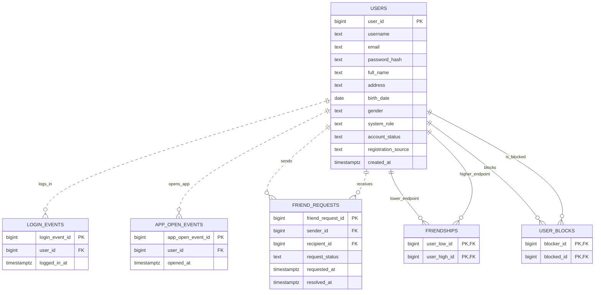
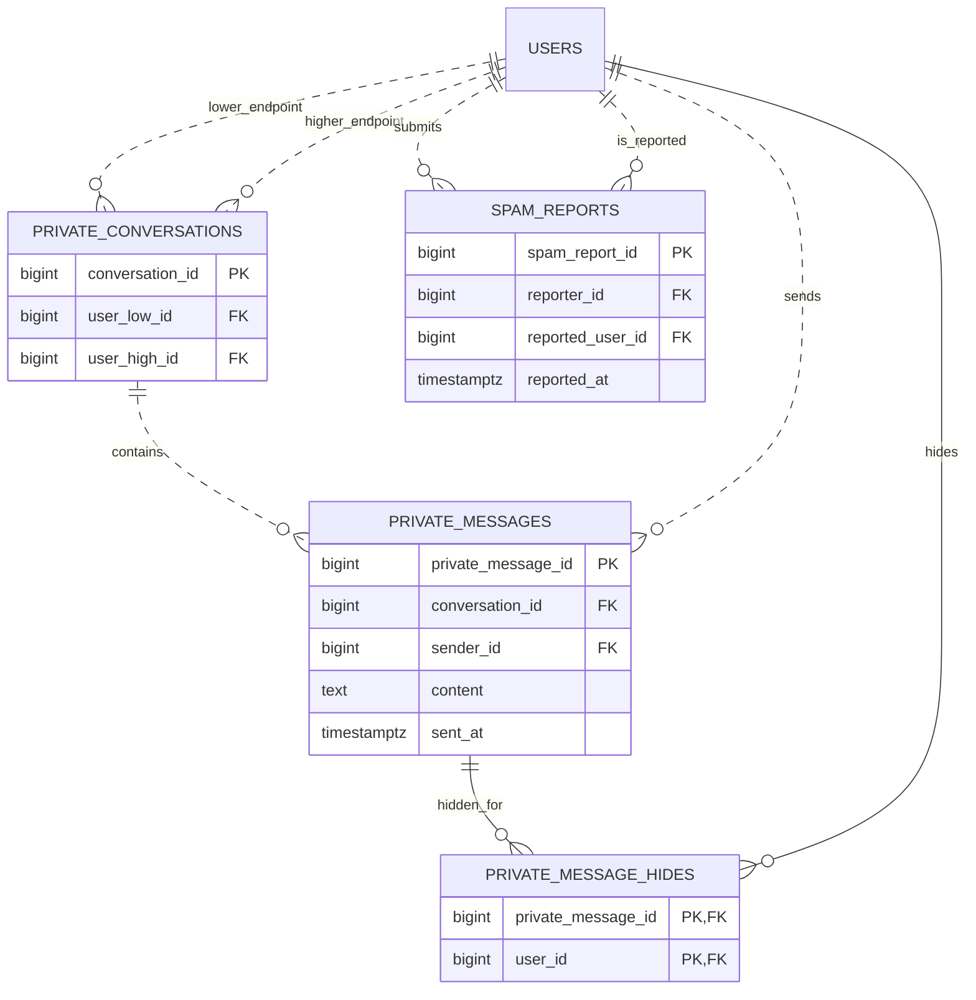
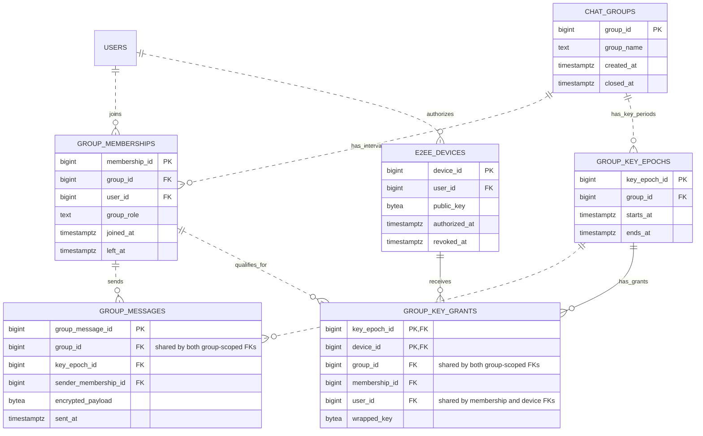

# Thiết kế cơ sở dữ liệu V1 — Java Chat System

**Trạng thái:** Thiết kế cơ sở dữ liệu V1, chờ review bàn giao · **Môi trường đích:** PostgreSQL 17.11

**Cơ sở:** [Đề bài](../Final_Project_He_Thong_Chat_Chi_Tiet.md), Requirements Specification (Prompt 02) và Decision Log đã phê duyệt (Prompt 03). Ba ERD dưới đây mô tả 16 bảng phục vụ cả Admin và User theo [schema V1](../../script/schema.sql). Giao thức mã hóa thuộc phần tích hợp V2.

## 1. Tài khoản, hoạt động và quan hệ xã hội



| Bảng | Mục đích |
|---|---|
| `users` | Hồ sơ, hash mật khẩu, quyền Admin/User, trạng thái hoạt động/khóa/đã xóa và nguồn tạo tài khoản. Dùng cùng danh tính nội bộ xuyên suốt các phân hệ. |
| `login_events` | Mỗi lần xác thực thành công. Lịch sử lấy tên đăng nhập và họ tên từ hồ sơ hiện tại. |
| `app_open_events` | Mỗi lần mở ứng dụng khi xác định được tài khoản, kể cả khi dùng lại phiên. Nguồn đếm lượt mở và số người mở theo tháng. |
| `friend_requests` | Lời mời có hướng, lưu thời điểm gửi và kết quả chờ, đồng ý, từ chối hoặc hủy. |
| `friendships` | Quan hệ bạn bè hiện hành, mỗi cặp không thứ tự có đúng một bản ghi. Nguồn cho danh sách bạn bè và thống kê bạn trực tiếp, bạn của bạn. |
| `user_blocks` | Quan hệ block có hướng để áp dụng quy tắc tìm người, lời mời và chat riêng. |

**Ràng buộc chính**

- `user_id` giữ nguyên và là đích của mọi tham chiếu đến tài khoản. Với tài khoản chưa xóa, bắt buộc có `username`, `email`, họ tên và hash mật khẩu. PostgreSQL dùng hai chỉ mục duy nhất có điều kiện, áp dụng cho cả tài khoản hoạt động và bị khóa: so sánh `username` có phân biệt hoa/thường và so sánh email qua biểu thức chuyển về chữ thường. Luồng tra cứu dùng cùng quy tắc. Địa chỉ, ngày sinh, giới tính có thể để trống. Nguồn tạo phân biệt tự đăng ký với cấp nội bộ để thống kê đăng ký mới.
- Xóa tài khoản là soft delete kết hợp ẩn danh. Trong cùng một giao dịch, chuyển trạng thái sang đã xóa và đặt `username`, `email`, hash mật khẩu cùng thông tin hồ sơ nhận diện về `NULL`. Ràng buộc theo trạng thái yêu cầu `username` và `email` là `NULL` ở bản ghi đã xóa. Nhãn ẩn danh chỉ dùng khi hiển thị. Sau khi giao dịch hoàn tất, có thể dùng lại username/email cũ cho tài khoản có `user_id` mới. Tin nhắn, lịch sử đăng nhập, báo cáo và sự kiện cũ vẫn tham chiếu `user_id` cũ. Tài khoản bị khóa vẫn giữ username/email và bị chặn đăng nhập mới.
- Chuẩn hóa cặp bạn bè theo `user_low_id < user_high_id`. Lời mời và block cấm tự trỏ. Khi chấp nhận lời mời, cập nhật lời mời và tạo quan hệ bạn bè nhất quán. Khi block, hủy kết bạn và lời mời đang chờ giữa hai bên trong cùng giao dịch. Bên bị block không thể gửi lại lời mời hoặc tìm thấy người chặn. Chat riêng kiểm tra block theo cả hai chiều.
- **Phân công ở Prompt 06.** Trigger tạo block hủy quan hệ bạn bè và lời mời đang chờ. PostgreSQL từ chối lời mời từ người bị block tới người chặn, đồng thời từ chối chấp nhận lời mời hoặc tạo quan hệ bạn bè khi có block theo một trong hai chiều. Backend xác thực người thao tác, chỉ cho người nhận xử lý lời mời, cập nhật lời mời `PENDING` và tạo quan hệ bạn bè trong cùng giao dịch. Backend cũng áp dụng điều kiện block khi tìm người.
- Trigger yêu cầu lời mời mới bắt đầu ở `PENDING`. Chỉ mục duy nhất có điều kiện dùng hai đầu mút đã sắp thứ tự để mỗi cặp chỉ có một lời mời `PENDING`, kể cả khi gửi ngược chiều.
- Các thao tác ghi kiểm tra block dùng `READ COMMITTED` và khóa giao dịch theo cặp không thứ tự qua `lock_social_pair`. Với luồng có nhiều câu lệnh như chấp nhận lời mời, backend lấy khóa cặp trước khi cập nhật các bản ghi. Cơ chế này cho phép kiểm tra lại trạng thái block sau khi chờ giao dịch trước hoàn tất.

## 2. Chat riêng, lịch sử cá nhân và spam

`USERS` trong các sơ đồ sau tham chiếu cùng bảng `users` ở mục 1.



| Bảng | Mục đích |
|---|---|
| `private_conversations` | Cuộc trò chuyện của một cặp tài khoản. Xác định người nhận từ đầu còn lại của cặp và dùng lại cùng cuộc trò chuyện khi hai người tiếp tục chat. |
| `private_messages` | Lưu tin nhắn để người nhận offline có thể đọc sau. ID và thời điểm gửi phục vụ lịch sử, tìm kiếm, mở đúng đoạn chat, thống kê và điều kiện báo cáo. |
| `private_message_hides` | Ghi một tin đã bị ẩn với một người tham gia. Xóa một/nhiều dòng và xóa toàn bộ lịch sử dùng cùng cơ chế, theo tập tin hiện có tại thời điểm thao tác. |
| `spam_reports` | Báo cáo ở mức tài khoản từ người từng chat riêng với người bị báo cáo. Mỗi lần báo cáo là một bản ghi riêng, không bắt buộc gắn tin nhắn. |

**Ràng buộc chính**

- Cặp trong `private_conversations` duy nhất, có `user_low_id < user_high_id` và không đổi sau khi tạo. Khi thêm tin, trigger PostgreSQL đối chiếu người gửi với hai đầu mút của cuộc trò chuyện và kiểm tra block theo cả hai chiều. Tin nhắn riêng chỉ ghi thêm, giữ nguyên nội dung và sự kiện gửi sau khi ghi để phục vụ lịch sử, thống kê và báo cáo spam.
- Lịch sử và tìm kiếm chỉ trả tin thuộc các cuộc trò chuyện của người xem, sau khi lọc những tin người đó đã ẩn. Tìm chuỗi trong một cuộc hoặc toàn bộ chat riêng đều trả ID tin và cuộc trò chuyện để mở đúng đoạn. Sắp thứ tự ổn định theo `sent_at` và ID khi trùng thời điểm.
- Ẩn lịch sử chỉ tạo bản ghi ở `private_message_hides`. Trigger xác nhận `user_id` là người tham gia cuộc trò chuyện. Backend lấy `user_id` từ phiên của người thực hiện, ghi các dòng ẩn theo phạm vi được chọn và lọc chúng khi đọc. Lịch sử của bên còn lại và sự kiện gửi dùng cho thống kê được giữ nguyên.
- Trigger kiểm tra cặp báo cáo đã có ít nhất một tin trong chat riêng. Tin đã bị ẩn với một bên vẫn là căn cứ. Backend xác thực người gửi báo cáo và quyền Admin khi đọc/khóa. Quản trị spam lọc/sắp xếp theo thời gian và tên đăng nhập hiện tại của **người bị báo cáo**, dùng danh tính ẩn danh nếu tài khoản đã xóa. Thao tác khóa cập nhật trạng thái ở `users`.

## 3. Nhóm chat và mã hóa đầu cuối



| Bảng | Mục đích |
|---|---|
| `chat_groups` | Tên, thời điểm tạo và thời điểm đóng nhóm. Nhóm đã đóng chuyển sang chỉ đọc theo quyền lịch sử đã có. |
| `group_memberships` | Một lần tham gia của một tài khoản, có vai trò theo nhóm và mốc vào/rời. Khi gia nhập lại, tạo khoảng thành viên mới để giữ ranh giới quyền đọc. |
| `e2ee_devices` | Khóa công khai và thời gian thiết bị được cấp quyền giải mã. Giữ lịch sử thiết bị cũ để xác định phạm vi cấp quyền. |
| `group_key_epochs` | Định danh từng giai đoạn sử dụng khóa nhóm. Làm ranh giới giữa các tập thành viên hoặc thiết bị có quyền giải mã khác nhau. |
| `group_key_grants` | Gói khóa nhóm đã mã hóa cho thiết bị đủ quyền trong một giai đoạn, gắn với khoảng thành viên làm căn cứ. Khóa riêng và khóa nhóm dạng rõ nằm phía thiết bị. |
| `group_messages` | Nội dung đã mã hóa và thời điểm gửi. Khoảng thành viên xác định người gửi. Giai đoạn khóa xác định nhóm và dữ liệu cần để client giải mã. |

**Ràng buộc chính**

- Khi tạo nhóm, ghi người tạo với quyền admin và tối thiểu một người được thêm. Chỉ mục duy nhất có điều kiện trên cặp `(group_id, user_id)` áp dụng khi `left_at` là `NULL`, bảo đảm tối đa một khoảng thành viên đang mở kể cả khi ghi đồng thời. Các khoảng đã đóng được giữ lại. Admin nhóm quản lý thêm/xóa thành viên và cấp quyền admin. Admin cuối cùng phải chuyển quyền trước khi chủ động rời nhóm còn thành viên. Nếu tài khoản đó bị xóa, đóng nhóm và giữ lịch sử theo các khoảng quyền đã có.
- **PostgreSQL bảo đảm cùng nhóm và cùng chủ thiết bị bằng FK ghép.** `group_messages` dùng chung `group_id` cho FK đến membership và epoch. `group_key_grants` tham chiếu epoch qua `(group_id, key_epoch_id)`, membership qua `(group_id, membership_id, user_id)` và thiết bị qua `(device_id, user_id)`. `user_id` dùng chung buộc thiết bị thuộc đúng tài khoản của membership. Các bộ cột đích có ràng buộc duy nhất và các thành phần FK bắt buộc có giá trị.
- Chỉ một thiết bị của mỗi tài khoản được cấp quyền giải mã tại một thời điểm. Khi tập thiết bị đủ quyền của nhóm thay đổi, sử dụng giai đoạn khóa mới trước khi gửi tin với tập quyền mới. Thành viên mới hoặc gia nhập lại không được cấp khóa cho thời gian họ vắng mặt. Khi thay thiết bị, thiết bị mới chỉ được cấp khóa cho tin phát sinh sau khi thiết bị đó được cấp quyền. Giới hạn này kiểm soát quyền cấp từ hệ thống, không bảo đảm xóa được bản sao hoặc khóa đã nằm trên thiết bị cũ.
- **Hiệu lực khi ghi E2EE.** Trigger chỉ cho ghi gói khóa khi nhóm, epoch, membership và thiết bị đều đang mở. Epoch phải bắt đầu từ hoặc sau cả mốc tham gia nhóm và mốc cấp quyền thiết bị. Trigger ghi tin cũng từ chối epoch bắt đầu trước lần tham gia của người gửi. Việc đóng các khoảng thời gian giữ nguyên gói khóa và tin đã ghi để phục vụ lịch sử theo quyền. PK ghép giới hạn một gói khóa cho mỗi cặp epoch–thiết bị.
- Backend/UI cần xác nhận thời điểm chuyển epoch khi thành viên hoặc thiết bị đổi, bên chịu trách nhiệm tạo và phân phối khóa, cùng định dạng ciphertext/gói khóa. Baseline giữ nguyên một thiết bị tại một thời điểm, không chuyển khóa giữa thiết bị và không cấp lịch sử ngoài khoảng quyền đã chốt. Danh sách nhóm, thành viên và admin được truy xuất mà không cần giải mã nội dung.

**Phân công giữa PostgreSQL và V2**

- **PostgreSQL:** Chỉ mục duy nhất có điều kiện giới hạn một membership đang mở cho mỗi cặp nhóm–người dùng, một thiết bị đang được cấp quyền cho mỗi tài khoản và một epoch mở cho mỗi nhóm. Trigger kiểm tra mốc thời gian và giữ khóa chia sẻ trên các bản ghi được kiểm tra đến hết giao dịch ghi tin hoặc gói khóa. ERD biểu diễn số lượng membership theo FK vật lý. Quy tắc tạo nhóm với ít nhất hai membership thuộc giao dịch backend.
- **Backend:** Tạo nhóm, membership `ADMIN` của người tạo và ít nhất một membership của người được thêm trong cùng giao dịch. Xác thực quyền admin khi thêm/xóa thành viên hoặc cấp quyền admin, kiểm tra quy tắc admin cuối cùng, cập nhật `left_at` thay vì xóa lịch sử và đóng nhóm khi cần theo quyết định đã chốt. Khi ghi tin, backend lấy người gửi từ phiên đã xác thực và đặt thời điểm gửi phía máy chủ. Luồng thay đổi membership, đóng nhóm và chuyển epoch lấy khóa trên bản ghi nhóm trước khi ghi để đồng bộ với luồng gửi.
- **Backend/UI và `DL-16`:** Backend xác thực người gọi, chỉ trả gói khóa và lịch sử trong khoảng quyền được phép, và điều phối mốc kết thúc/bắt đầu các khoảng để chúng không chồng lấn. Sau khi quyền thành viên hoặc thiết bị thay đổi, backend phải chuyển epoch trước khi cho gửi tin với tập quyền mới. Nhóm vẫn cần chốt bên tạo/phân phối khóa, thời điểm chuyển epoch trong luồng thực tế và định dạng ciphertext/gói khóa. PostgreSQL chỉ lưu khóa công khai, gói khóa đã mã hóa và nội dung mã hóa. Khả năng giải mã thực tế cần kiểm thử khi tích hợp V2.

## 4. Truy xuất báo cáo và phần dùng dữ liệu có sẵn

| Yêu cầu | Nguồn và quy tắc |
|---|---|
| `ADM-01`–`ADM-04` | Hồ sơ và sự kiện đăng nhập, thành viên nhóm, báo cáo spam lấy từ các bảng nghiệp vụ. Trạng thái khóa dùng chung giữa quản lý tài khoản và quản lý spam. |
| `ADM-05/06` | Lọc `users` theo `created_at` và nguồn tự đăng ký. Tổng hợp theo tháng của năm đã chọn. Admin tạo tài khoản không làm tăng số lượt tự đăng ký. |
| `ADM-07` | Dùng `friendships` theo cả hai chiều. Cột thứ hai là hợp của bạn trực tiếp và bạn của bạn, loại chính mình và loại trùng. |
| `ADM-08/09` | Đếm lượt mở app, số người nhận tin riêng phân biệt và số nhóm được gửi tin phân biệt trong kỳ theo người gửi. Ngưỡng lọc hoạt động dùng lượt mở app. Biểu đồ hoạt động đếm số người phân biệt mở app theo tháng. Ẩn lịch sử cá nhân hoặc ẩn danh tài khoản không xóa sự kiện nguồn. |
| `USR-03/08/11` | Reset qua email dùng email và hash mật khẩu ở `users`. Online/offline và phản hồi realtime lấy từ lớp kết nối, tin offline đọc từ lịch sử. Gợi ý LLM đi theo luồng ứng dụng, nội dung được gửi dùng bảng tin nhắn tương ứng. Các luồng này không yêu cầu thêm bảng riêng trong baseline. |

Thời điểm sự kiện dùng `timestamptz`. Báo cáo theo `Asia/Ho_Chi_Minh` và dùng khoảng nửa mở từ đầu ngày bắt đầu đến trước đầu ngày sau ngày kết thúc. Tìm theo họ tên, tên nhóm và chuỗi trong lịch sử chat riêng không phân biệt hoa/thường nhưng phân biệt dấu. Tìm theo tên đăng nhập giữ phân biệt hoa/thường. Báo cáo và biểu đồ được tổng hợp từ dữ liệu nguồn.

## 5. Thứ tự triển khai theo phụ thuộc

Các bảng cùng đợt có thể triển khai độc lập sau khi các đợt trước hoàn tất.

| Đợt | Bảng | Phụ thuộc trực tiếp |
|---|---|---|
| 1 | `users`, `chat_groups` | Bảng gốc. |
| 2 | `login_events`, `app_open_events`, `friend_requests`, `friendships`, `user_blocks`, `private_conversations`, `e2ee_devices` | FK đến `users`. |
| 2 | `group_memberships`, `group_key_epochs` | `chat_groups`. `group_memberships` còn tham chiếu `users`. |
| 3 | `private_messages` | `private_conversations`, `users`. |
| 3 | `group_key_grants`, `group_messages` | `group_key_epochs`, `group_memberships`. `group_key_grants` còn tham chiếu `e2ee_devices`. |
| 4 | `private_message_hides` | `private_messages`, `users`. |
| 4 | `spam_reports` | FK đến `users`. Kiểm tra nghiệp vụ cần `private_conversations` và `private_messages`. |

## 6. Bàn giao và tái hiện kiểm thử V1

Tạo một database thử nghiệm mới trên PostgreSQL 17.11 rồi chạy từ thư mục gốc repository. `schema.sql` khởi tạo trên database trống. `seed.sql` nạp một lần dữ liệu mẫu cho cả 16 bảng. Hash mật khẩu, khóa và nội dung mã hóa trong seed là dữ liệu giả dành cho kiểm thử DB.

```powershell
psql -X -d java_chat_v1_test -v ON_ERROR_STOP=1 -f script/schema.sql
psql -X -d java_chat_v1_test -v ON_ERROR_STOP=1 -f script/seed.sql
psql -X -d java_chat_v1_test -v ON_ERROR_STOP=1 -f script/tests/verify.sql
```

Bộ xác nhận SQL chạy trong giao dịch và rollback các thao tác thử. Bộ này kiểm tra cấu trúc, vòng đời tài khoản, quan hệ xã hội, chat riêng và spam, lịch sử thành viên, ràng buộc metadata E2EE, cùng các truy vấn theo giờ Việt Nam. Các kiểm tra liên quan đến phiên, quyền theo người gọi, chuyển khóa và khả năng giải mã thuộc tích hợp V2.

Trong lượt bàn giao, schema và seed chạy thành công trên database trống dùng đúng ảnh Docker PostgreSQL 17.11 của `chat-postgres`. PostgreSQL ghi nhận 16 PK, 25 FK, 21 CHECK, 5 ràng buộc UNIQUE, 44 chỉ mục (gồm chỉ mục do PK/UNIQUE tạo) và 10 trigger nghiệp vụ. Bảy nhóm xác nhận trong `verify.sql` đều đạt. Một ca thử bổ sung với hai phiên xác nhận tin nhắn chờ giao dịch block và bị từ chối sau khi block commit.
