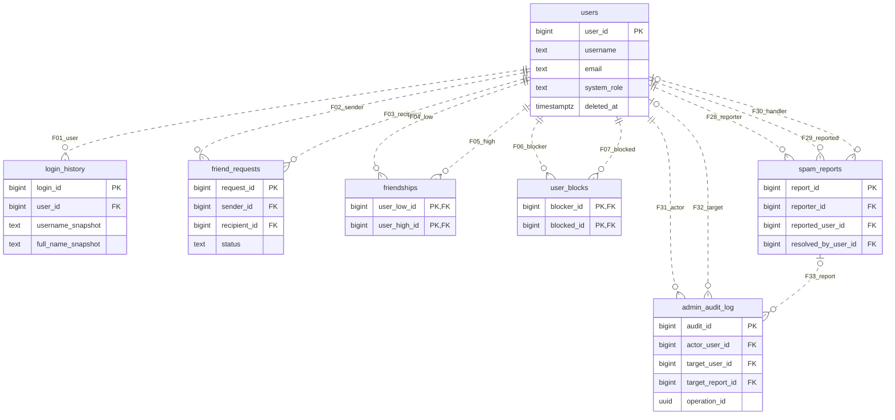
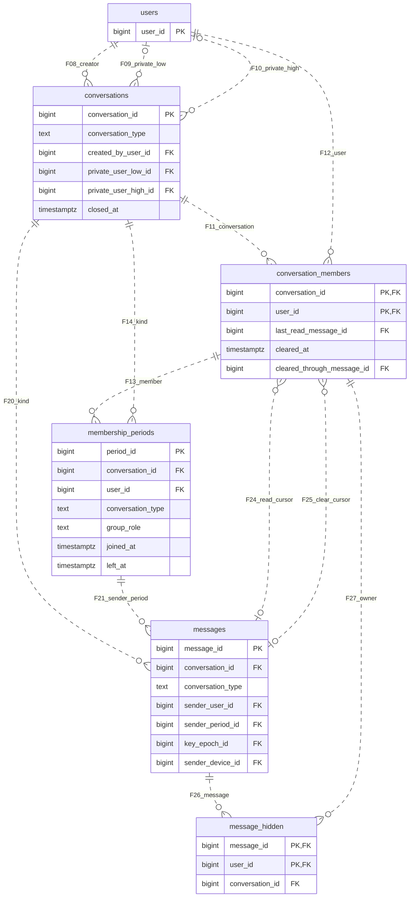
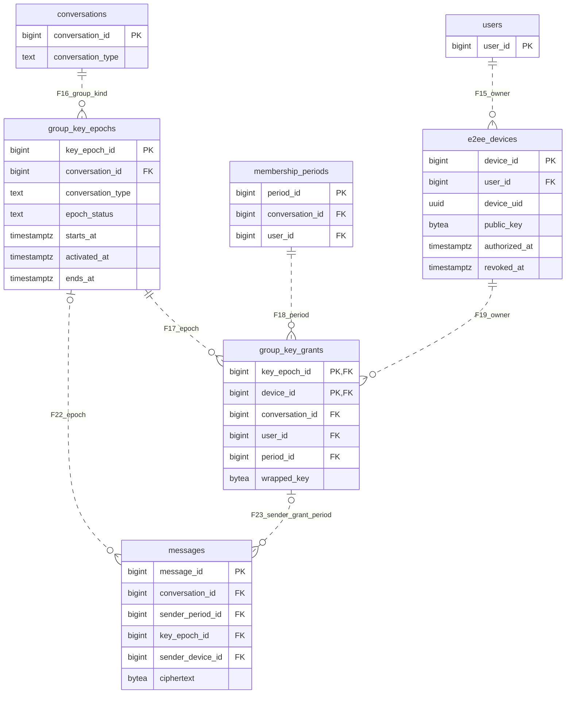

# PostgreSQL detailed design for JAVA CHAT SYSTEM

| Field | Value |
|---|---|
| Feature / owner | database-schema / Minh |
| Design status | APPROVED DESIGN / IN_PROGRESS acceptance; fresh test schema/seed/query/SQL checks executed |
| Design date | 19/11/2026, live Asia/Ho_Chi_Minh date |
| Plan approval | YES (19/11/2026); [plan](ai/database-schema/plan.md) |
| Detailed design approval | YES (19/11/2026), explicit approval before schema implementation |
| Current session | Final review of unchanged SQL/tests and recorded runtime evidence; four docs/tracker only; no SQL rerun, application or external handoff edits |
| Target | Actual PostgreSQL/psql 17.11 (170011); chat-postgres a0786fdd6fe1, published 127.0.0.1:5432; exact test DB in section 12 |
| Detailed choices | R1=B and R2=A explicitly confirmed by Minh on 19/11/2026; both RESOLVED |

## 1. Basis and scope

This approved design is reflected in [schema.sql](../../script/schema.sql), replacing the old trigger-based split model in that file. It has now run with matching fixtures, prepared queries and isolated checks in the new dedicated database identified in section 12. Prior runtime results for the old model are not reused as evidence. No business database was queried or changed; this is fresh-database work without migration/backfill.

Minh's explicit decisions override conflicting Word and older documents. The Word source `docs/Phuong_an_da_chot_JAVA_CHAT_SYSTEM.docx` was successfully read in the initial review. Retain its non-conflicting decisions. Do not invent a D40 decision.

Confirmed choices are not reopened: S1 stores the ordered PRIVATE pair in conversations; Q1=B allows exceptional group closure when no eligible successor exists, preserving data/history; Q2=A uses administration audit/manual control retry, without an outbox; Q3=B uses a stable conversation_members row and membership_periods; Q4=A keeps clear time plus an ID watermark. Q8-A/O4 allow at most one currently authorized E2EE device per account, no historical key grants for newly authorized devices, no transfer/backup/recovery secrets. Same still-authorized installation re-login preserves local keys. Every group is E2EE at creation with at least three people, including the creator.

Minh explicitly selected **R1=B** (PENDING/ACTIVE/CLOSED epochs), **R2=A** (versioned opaque envelopes) and approved the detailed design on 19/11/2026. Pre-implementation review matched every Q1–Q4/R1–R2 choice to an actual reply; no DDL-affecting named question remains. Dictionary and source agree and catalog/SQL checks have run; cryptographic/application integration remains NOT RUN.

Use only tables, identity, PK, FK, NOT NULL, UNIQUE, CHECK, DEFAULT and justified indexes. No business trigger, procedure, custom function, cross-table CHECK, exclusion constraint or extension. Built-in expressions such as lower, btrim, LEAST and GREATEST are allowed.

## 2. Tables and purposes

schema.sql declares 15 tables as a consequence of this model, not a legacy count requirement: 109 columns, 15 PKs, 6 table UNIQUE constraints, 33 FKs, 46 CHECKs and 36 explicit indexes (8 unique). A00 corroborated these totals against the actual test catalog; 57 total indexes include 21 PK/UNIQUE backing indexes.

| Table | Purpose |
|---|---|
| users | Retained profile/identity, application password hash, system role, lock/deletion state |
| login_history | Successful UserApp logins with name/username snapshots; sole app-open source |
| admin_audit_log | AdminApp authentication, account/report actions and control request/outcome events |
| friend_requests | Directed invitations and resolution history |
| friendships | One ordered current friendship pair |
| user_blocks | Directed current block pairs |
| conversations | Shared PRIVATE/GROUP identity; PRIVATE endpoints or GROUP metadata |
| conversation_members | One permanent row per conversation/user with personal read/clear state |
| membership_periods | Each join/leave interval and its group role |
| messages | Retained PRIVATE text or GROUP ciphertext, linked to exact sending period/grant |
| message_hidden | Per-user hides independent of participation interval |
| spam_reports | Directed reports, optional reason and processing metadata |
| e2ee_devices | Public keys and device authorization generations |
| group_key_epochs | GROUP key cutovers and proposed readiness state |
| group_key_grants | Wrapped key for one epoch/device/participation period |

System ADMIN (`users.system_role`) is distinct from group ADMIN (`membership_periods.group_role`). System administration does not imply group membership, group privileges or access to group keys.

## 3. Mermaid ERDs

Only key columns are drawn; section 5 lists every column. F01–F33 labels correspond exactly to the FK catalog. Each composite edge represents one FK. Physical child counts can be zero: exactly two PRIVATE member rows and initial GROUP minimum size are application transaction invariants.

### 3.1 Accounts, social relations and administration

### 3.2 Conversations, periods and personal state

### 3.3 E2EE scope and sender grant

## 4. Global conventions

- Default `ID` means GENERATED ALWAYS AS IDENTITY for a bigint surrogate PK. Composite PKs have no extra identity.
- Default `NOW` means CURRENT_TIMESTAMP. It is a transaction-start default, not a commit-order clock. The application supplies one authoritative cutover instant after locks for multi-step changes and validates local ordering. Client timestamps cannot backdate membership/device rights. Clock anomalies fail/retry rather than granting old keys.
- `none` means no explicit DEFAULT: required values must be supplied. `NULL` means explicit DEFAULT NULL in schema.sql. UUIDs are application-supplied; no custom DB generator is used.
- Timestamps are timestamptz. Reports use explicit Asia/Ho_Chi_Minh half-open intervals `[start,end)`.
- Every CHECK is row-local. Required conditional values use explicit IS NOT NULL/IS NULL branches so SQL UNKNOWN does not accidentally permit an incomplete payload/profile.
- Every FK uses ON DELETE RESTRICT, ON UPDATE RESTRICT, MATCH SIMPLE, NOT DEFERRABLE / immediate. Parents and historical children are retained. This does not prohibit hard deletion of every unreferenced row or changes to unrelated columns.
- Composite FK targets below are immediate PK/UNIQUE constraints, not partial unique indexes. Wider target keys are deliberate scope/owner proofs.
- No normal-group flag, server-held plaintext group key, private key, key backup or recovery secret is stored.

## 5. Data dictionary and local constraints

Every declared column appears below. Static review compared all 109 names/types/nullability/defaults against schema.sql; R1/R2 identify confirmed choices. PostgreSQL accepted the DDL and A00 checked catalog totals; this iteration changes no column, key or index design.

### 5.1 users

| Column | Type | Nullable | Default | Meaning |
|---|---|---|---|---|
| user_id | bigint | NO | ID | Retained account PK |
| username | text COLLATE "C" | NO | none | Display spelling, normalized case-insensitive uniqueness/login |
| email | text | NO | none | Required trimmed email |
| password_hash | text | NO | none | Application BCrypt output |
| full_name | text | NO | none | Current name |
| address | text | YES | NULL | Optional address |
| birth_date | date | YES | NULL | Optional birth date |
| gender | text | YES | NULL | Optional value; no invented closed vocabulary |
| system_role | text | NO | 'USER' | USER or system ADMIN |
| account_status | text | NO | 'ACTIVE' | ACTIVE/LOCKED, separate from deletion |
| registration_source | text | NO | none | SELF_REGISTERED/INTERNAL |
| must_change_password | boolean | NO | false | D9 reminder; does not itself force a UI flow |
| created_at | timestamptz | NO | NOW | Original creation time |
| deleted_at | timestamptz | YES | NULL | Retained-profile soft deletion |

PK(user_id). CHECK username matches `^[A-Za-z0-9_]{3,30}$`; btrim(email), btrim(full_name) and btrim(password_hash) are each nonempty; email=btrim(email); listed role/status/source domains; ADMIN implies INTERNAL; deleted_at is NULL or >=created_at. No moving-current-date birth-date CHECK. Application validates email syntax/password strength/hash, immutable username/source/time, legal lifecycle and login eligibility.

I01/I02 are global unique normalized indexes, including locked/deleted rows. Login lookup uses the same lower(username COLLATE "C") expression; the ASCII rule makes username normalization deterministic. Email uses lower(email) consistently; no provider-specific dot/plus-address normalization is invented. Deletion never clears profiles or releases identifiers.

### 5.2 login_history

| Column | Type | Nullable | Default | Meaning |
|---|---|---|---|---|
| login_id | bigint | NO | ID | Successful event PK |
| user_id | bigint | NO | none | UserApp account, F01 |
| logged_in_at | timestamptz | NO | NOW | Successful authentication instant |
| username_snapshot | text | NO | none | Username at login |
| full_name_snapshot | text | NO | none | Name at login |
| remote_ip | inet | YES | NULL | Optional source for existing admin UI |

PK(login_id); CHECK both snapshots nonblank. F01 preserves identity but cannot prove snapshot authenticity. Server writes one row per completed logical UserApp authentication, without duplicating network retries or counting reconnects without a new success. AdminApp writes audit instead. Later profile edits/deletion do not modify snapshots. Append-only semantics are application-owned.

### 5.3 friend_requests

| Column | Type | Nullable | Default | Meaning |
|---|---|---|---|---|
| request_id | bigint | NO | ID | Invitation PK |
| sender_id | bigint | NO | none | Sender F02 |
| recipient_id | bigint | NO | none | Recipient F03 |
| status | text | NO | 'PENDING' | PENDING/ACCEPTED/REJECTED/CANCELLED |
| requested_at | timestamptz | NO | NOW | Sent time |
| resolved_at | timestamptz | YES | NULL | Resolution time |

PK(request_id); CHECK sender_id<>recipient_id, status domain, PENDING implies resolved_at NULL, otherwise resolved_at NOT NULL and >=requested_at. I07 gives one unordered pending pair. The application performs reciprocal auto-accept; the index alone only rejects a duplicate insert. Actor/transition permissions are not DB CHECKs.

### 5.4 friendships

| Column | Type | Nullable | Default | Meaning |
|---|---|---|---|---|
| user_low_id | bigint | NO | none | Smaller endpoint F04 |
| user_high_id | bigint | NO | none | Larger endpoint F05 |
| created_at | timestamptz | NO | NOW | Current friendship creation time |

PK(user_low_id,user_high_id); CHECK user_low_id < user_high_id. Unfriend/block removes only the current relationship. Re-friending creates a fresh relationship/time; messages and invitation history remain.

### 5.5 user_blocks

| Column | Type | Nullable | Default | Meaning |
|---|---|---|---|---|
| blocker_id | bigint | NO | none | Actor F06 |
| blocked_id | bigint | NO | none | Target F07 |
| created_at | timestamptz | NO | NOW | Block time |

PK(blocker_id,blocked_id); CHECK distinct endpoints. Opposite-direction blocks are independent; unblock does not restore friendship/pending invitations.

### 5.6 conversations

| Column | Type | Nullable | Default | Meaning |
|---|---|---|---|---|
| conversation_id | bigint | NO | ID | Shared PK |
| conversation_type | text | NO | none | PRIVATE/GROUP |
| created_by_user_id | bigint | NO | none | Creator F08 |
| private_user_low_id | bigint | YES | NULL | PRIVATE smaller endpoint F09 |
| private_user_high_id | bigint | YES | NULL | PRIVATE larger endpoint F10 |
| group_name | text | YES | NULL | GROUP name only |
| created_at | timestamptz | NO | NOW | Creation time |
| closed_at | timestamptz | YES | NULL | Exceptional GROUP closure |

PK(conversation_id); U01 UNIQUE(conversation_id,conversation_type). CHECK domain and exhaustive shape:

- PRIVATE: endpoints both NOT NULL, low<high, group_name NULL, closed_at NULL, creator equals one endpoint.
- GROUP: endpoints both NULL, group_name NOT NULL and trimmed nonempty; closed_at NULL or >=created_at.

I12 prevents duplicate canonical PRIVATE pairs. Group names are not unique. Conversation kind/endpoints/creator/created_at are immutable through application paths.

**Exactly two PRIVATE people:** the canonical pair contains exactly two distinct accounts. The creation transaction inserts exactly those endpoint members and initial periods, or rolls back. The approved minimal model does not declaratively prevent a third member row, missing endpoint membership or later endpoint rewrite through arbitrary SQL. Application authorization forbids those operations. Sender FKs prove membership in the stored conversation, not independently that an incorrectly inserted third member matches an endpoint. This is the explicit DB/application boundary already in the approved plan, not a claim that FK can count children.

### 5.7 conversation_members

| Column | Type | Nullable | Default | Meaning |
|---|---|---|---|---|
| conversation_id | bigint | NO | none | Conversation F11 |
| user_id | bigint | NO | none | Stable personal-state owner F12 |
| member_created_at | timestamptz | NO | NOW | First association |
| last_read_message_id | bigint | YES | NULL | Monotonic read cursor F24 |
| cleared_at | timestamptz | YES | NULL | Latest full-clear time |
| cleared_through_message_id | bigint | YES | NULL | Exact clear cutoff F25 |

PK(conversation_id,user_id) gives one stable row across departures/rejoins. CHECK `cleared_at IS NOT NULL OR cleared_through_message_id IS NULL`; empty clear may set time with NULL cutoff. F24/F25 bind IDs to this conversation; use no zero sentinel. They cannot prove history/decryption eligibility or monotonicity. Do not reset these fields on rejoin.

### 5.8 membership_periods

| Column | Type | Nullable | Default | Meaning |
|---|---|---|---|---|
| period_id | bigint | NO | ID | Participation interval PK |
| conversation_id | bigint | NO | none | Stable member scope F13/F14 |
| user_id | bigint | NO | none | Stable member owner F13 |
| conversation_type | text | NO | none | Bound discriminator F14 |
| group_role | text | NO | 'MEMBER' | MEMBER/group ADMIN |
| joined_at | timestamptz | NO | NOW | Start |
| left_at | timestamptz | YES | NULL | Departure/removal boundary |

PK(period_id); U02 UNIQUE(conversation_id,user_id,period_id). CHECK role/type domains, PRIVATE implies MEMBER, left_at NULL or >=joined_at. I18 allows at most one open interval per stable member. The application prevents overlaps among historical intervals and uses `[joined_at,left_at)` eligibility with stored period/epoch IDs, not client times alone.

Role is current within that interval: promotion/demotion updates it; no full role-change ledger is claimed. Rejoining starts another period with MEMBER unless explicitly granted ADMIN; initial creator is ADMIN. System ADMIN grants no implicit group rights.

### 5.9 e2ee_devices

| Column | Type | Nullable | Default | Meaning |
|---|---|---|---|---|
| device_id | bigint | NO | ID | Authorization generation PK |
| user_id | bigint | NO | none | Account owner F15 |
| device_uid | uuid | NO | none | Stable client installation identifier |
| public_key | bytea | NO | none | Public key envelope R2-A |
| key_format_version | smallint | NO | 1 | Positive public-key codec version R2-A |
| authorized_at | timestamptz | NO | NOW | Authorization start |
| revoked_at | timestamptz | YES | NULL | Revocation |

PK(device_id); U03 UNIQUE(device_id,user_id). CHECK nonempty public_key, version>0, revoked_at NULL or >=authorized_at. I20 gives at most one unrevoked device per account, not at least one.

A device_uid is not hardware attestation: authenticate the account and prove private-key possession. Same still-authorized installation re-login reuses device_id/authorized_at and keeps local keys. Switching revokes the old generation and inserts a new one. Returning to a previously revoked installation creates another generation, even with the same historical device_uid; do not reopen its old authorization or grant it old keys. Existing local copies cannot be erased by DB revocation.

### 5.10 group_key_epochs

| Column | Type | Nullable | Default | Meaning |
|---|---|---|---|---|
| key_epoch_id | bigint | NO | ID | Epoch PK |
| conversation_id | bigint | NO | none | GROUP F16 |
| conversation_type | text | NO | 'GROUP' | GROUP-only discriminator |
| epoch_status | text | NO | 'PENDING' | PENDING/ACTIVE/CLOSED R1-B |
| starts_at | timestamptz | NO | NOW | Authorization cutover |
| activated_at | timestamptz | YES | NULL | Send readiness R1-B |
| ends_at | timestamptz | YES | NULL | End |

PK(key_epoch_id); U04 UNIQUE(conversation_id,key_epoch_id). CHECK type='GROUP'; status domain; activated_at NULL or >=starts_at; ends_at NULL or >=starts_at; if both exist, ends_at>=activated_at. PENDING requires activated_at/ends_at NULL; ACTIVE requires activated_at NOT NULL and ends_at NULL; CLOSED requires ends_at NOT NULL and allows NULL activated_at for an abandoned pending epoch. I22 counts PENDING too: at most one unended epoch per group. Legal transitions and historical non-overlap remain application rules.

### 5.11 group_key_grants

| Column | Type | Nullable | Default | Meaning |
|---|---|---|---|---|
| key_epoch_id | bigint | NO | none | Epoch F17 |
| device_id | bigint | NO | none | Recipient device F19 |
| conversation_id | bigint | NO | none | Shared GROUP F17/F18 |
| user_id | bigint | NO | none | Shared period/device owner F18/F19 |
| period_id | bigint | NO | none | Recipient participation F18 |
| wrapped_key | bytea | NO | none | Opaque wrapped-key envelope R2-A |
| envelope_version | smallint | NO | 1 | Positive wrapping codec version R2-A |
| granted_at | timestamptz | NO | NOW | Grant time |

PK(key_epoch_id,device_id); U05 UNIQUE(key_epoch_id,device_id,period_id) targets sender-grant FK. CHECK nonempty bytes and version>0. Shared conversation_id prevents wrong group/epoch/period; shared user_id prevents granting a member's key to another person's device. Temporal eligibility/open-state/batch correctness are application checks. Old grants remain after interval/device/epoch closure; retained bytes do not prove future eligibility.

### 5.12 messages

| Column | Type | Nullable | Default | Meaning |
|---|---|---|---|---|
| message_id | bigint | NO | ID | Retained PK and per-conversation ordering key |
| conversation_id | bigint | NO | none | Conversation F20/F21/F22 |
| conversation_type | text | NO | none | PRIVATE/GROUP F20 |
| sender_user_id | bigint | NO | none | Sender owner F21 |
| sender_period_id | bigint | NO | none | Exact participation F21/F23 |
| sent_at | timestamptz | NO | NOW | Server accepted-send instant |
| text_content | text | YES | NULL | PRIVATE-only text |
| ciphertext | bytea | YES | NULL | GROUP-only encrypted text envelope R2-A |
| payload_version | smallint | YES | NULL | GROUP-only positive version R2-A |
| key_epoch_id | bigint | YES | NULL | GROUP epoch F22/F23 |
| sender_device_id | bigint | YES | NULL | GROUP granted sender device F23 |

PK(message_id); U06 UNIQUE(conversation_id,message_id). CHECK type domain and exhaustive shape:

- PRIVATE requires text_content NOT NULL and length>0; ciphertext/payload_version/key_epoch_id/sender_device_id all NULL.
- GROUP requires text_content NULL, ciphertext NOT NULL and nonempty, payload_version NOT NULL and >0, key_epoch_id/sender_device_id both NOT NULL.

F21 ties sender_user_id and sender_period_id to conversation_id; F13 proves that period's stable member. F22 binds the epoch to the same GROUP. F23 requires the exact epoch/device/period grant; F18/F19 transitively bind its sender owner too. These checks do not prove current interval/device/epoch state or that the caller is that sender. Application validates current session/account/block, period/device, ACTIVE epoch and accepted time under locks. GROUP sender's grant proves existence of a wrapped-key record, not successful decryption or cryptographic validity.

Messages remain immutable/retained through application paths. Hide/clear/closure/soft deletion never deletes source messages or changes sender/content/time. FKs alone do not forbid every direct update/delete.

### 5.13 message_hidden

| Column | Type | Nullable | Default | Meaning |
|---|---|---|---|---|
| message_id | bigint | NO | none | Hidden message F26 |
| user_id | bigint | NO | none | Personal owner F27 |
| conversation_id | bigint | NO | none | Shared scope F26/F27 |
| hidden_at | timestamptz | NO | NOW | Hide time |

PK(message_id,user_id); no additional UNIQUE/CHECK needed. F26 binds message to conversation; F27 binds owner to the same conversation. Take user_id from the authenticated session. A retained past-member row alone does not authorize hiding a message outside entitled history. Hides are tied to stable owner, not period_id, so they survive rejoin and never affect another user's view.

### 5.14 spam_reports

| Column | Type | Nullable | Default | Meaning |
|---|---|---|---|---|
| report_id | bigint | NO | ID | Report PK |
| reporter_id | bigint | NO | none | Reporter F28 |
| reported_user_id | bigint | NO | none | Target F29 |
| reason | text | YES | NULL | Optional reason |
| status | text | NO | 'PENDING' | PENDING/RESOLVED/DISMISSED |
| reported_at | timestamptz | NO | NOW | Creation |
| resolved_at | timestamptz | YES | NULL | Last processing time |
| resolved_by_user_id | bigint | YES | NULL | System admin handler F30 |

PK(report_id); CHECK distinct endpoints, optional reason nonblank, listed status domain. PENDING requires both processing fields NULL; terminal states require both NOT NULL and resolved_at>=reported_at. I28 gives one directed PENDING pair; opposite direction is independent. F30 proves an account exists, not that its role is system ADMIN.

Application requires a retained incoming PRIVATE message from reported user to reporter, even if personally hidden/cleared. Outgoing-only or group-only evidence does not qualify. Locking a user resolves all reports about that user under literal D38, including prior DISMISSED; audit preserves previous processing. Ignoring one report sets DISMISSED. Future PENDING reports may be created after prior resolution if still eligible.

### 5.15 admin_audit_log

| Column | Type | Nullable | Default | Meaning |
|---|---|---|---|---|
| audit_id | bigint | NO | ID | Event PK |
| actor_user_id | bigint | NO | none | Authenticated system admin F31 |
| actor_username_snapshot | text | NO | none | Actor username at event |
| actor_full_name_snapshot | text | NO | none | Actor name at event |
| operation_id | uuid | NO | none | Logical action/control reqId |
| event_type | text | NO | none | Event domain below |
| outcome | text | NO | none | PENDING/SUCCESS/FAILED/UNKNOWN |
| target_user_id | bigint | YES | NULL | Optional target F32 |
| target_report_id | bigint | YES | NULL | Optional report F33 |
| event_at | timestamptz | NO | NOW | Event time |
| detail | text | YES | NULL | Non-secret explanation/prior report state |

PK(audit_id); CHECK actor snapshots nonblank; listed outcome domain; event_type in LOGIN_SUCCESS, USER_CREATED, USER_UPDATED, PASSWORD_RESET, USER_LOCKED, USER_UNLOCKED, USER_SOFT_DELETED, SPAM_DISMISSED, SPAM_RESOLVED, CONTROL_REQUESTED, CONTROL_ACKNOWLEDGED, CONTROL_FAILED, CONTROL_UNKNOWN. CONTROL events require target_user_id NOT NULL. Application validates event/outcome compatibility, actor role and report/target consistency when both IDs exist. Unauthenticated failed-login capture is not added.

Multiple rows intentionally share operation_id for request/failure/manual retry/acknowledgement. This is not an outbox or session table. The server retries the same logical command idempotently; DB success alone is not an ACK. No plaintext passwords/chat, private/group keys or recovery secrets enter detail. Audit append-only behavior is an application convention.

## 6. FK catalog and referential actions

For every F01–F33: **ON DELETE RESTRICT / ON UPDATE RESTRICT**, MATCH SIMPLE, NOT DEFERRABLE / immediate. No CASCADE erases history; no SET NULL silently discards identity/ownership. Key updates are restricted when referenced; IDs/type/ownership and retained rows are additionally immutable by application contract. Normal account deletion sets deleted_at. The nullable FK cases below are intentional, not a replacement for soft deletion.

| FK | Child columns | Exact parent key | Purpose / nullable behavior |
|---|---|---|---|
| F01 | login_history(user_id) | users(user_id) PK | Retained successful-login identity |
| F02 | friend_requests(sender_id) | users(user_id) PK | Sender |
| F03 | friend_requests(recipient_id) | users(user_id) PK | Recipient |
| F04 | friendships(user_low_id) | users(user_id) PK | Ordered endpoint |
| F05 | friendships(user_high_id) | users(user_id) PK | Ordered endpoint |
| F06 | user_blocks(blocker_id) | users(user_id) PK | Block actor |
| F07 | user_blocks(blocked_id) | users(user_id) PK | Block target |
| F08 | conversations(created_by_user_id) | users(user_id) PK | Retained creator |
| F09 | conversations(private_user_low_id) | users(user_id) PK | Required PRIVATE; GROUP NULL exempt |
| F10 | conversations(private_user_high_id) | users(user_id) PK | Required PRIVATE; GROUP NULL exempt |
| F11 | conversation_members(conversation_id) | conversations(conversation_id) PK | Permanent conversation scope |
| F12 | conversation_members(user_id) | users(user_id) PK | Permanent personal-state owner |
| F13 | membership_periods(conversation_id,user_id) | conversation_members(conversation_id,user_id) PK | Interval's stable member |
| F14 | membership_periods(conversation_id,conversation_type) | conversations(conversation_id,conversation_type) U01 | Correct role/type discriminator |
| F15 | e2ee_devices(user_id) | users(user_id) PK | Device owner |
| F16 | group_key_epochs(conversation_id,conversation_type) | conversations(conversation_id,conversation_type) U01 | GROUP-only epoch |
| F17 | group_key_grants(conversation_id,key_epoch_id) | group_key_epochs(conversation_id,key_epoch_id) U04 | Same GROUP/epoch |
| F18 | group_key_grants(conversation_id,user_id,period_id) | membership_periods(conversation_id,user_id,period_id) U02 | Same GROUP/period/owner |
| F19 | group_key_grants(device_id,user_id) | e2ee_devices(device_id,user_id) U03 | Same person owns device |
| F20 | messages(conversation_id,conversation_type) | conversations(conversation_id,conversation_type) U01 | Correct payload kind |
| F21 | messages(conversation_id,sender_user_id,sender_period_id) | membership_periods(conversation_id,user_id,period_id) U02 | Exact sender interval in conversation |
| F22 | messages(conversation_id,key_epoch_id) | group_key_epochs(conversation_id,key_epoch_id) U04 | GROUP's own epoch; PRIVATE NULL exempt |
| F23 | messages(key_epoch_id,sender_device_id,sender_period_id) | group_key_grants(key_epoch_id,device_id,period_id) U05 | Exact sender device/period grant; PRIVATE NULL exempt |
| F24 | conversation_members(conversation_id,last_read_message_id) | messages(conversation_id,message_id) U06 | Same-conversation read cursor; NULL allowed |
| F25 | conversation_members(conversation_id,cleared_through_message_id) | messages(conversation_id,message_id) U06 | Same-conversation clear cutoff; empty clear NULL |
| F26 | message_hidden(conversation_id,message_id) | messages(conversation_id,message_id) U06 | Hidden message in stated conversation |
| F27 | message_hidden(conversation_id,user_id) | conversation_members(conversation_id,user_id) PK | Hide owner in same conversation |
| F28 | spam_reports(reporter_id) | users(user_id) PK | Retained reporter |
| F29 | spam_reports(reported_user_id) | users(user_id) PK | Retained reported account |
| F30 | spam_reports(resolved_by_user_id) | users(user_id) PK | NULL pending, retained handler otherwise |
| F31 | admin_audit_log(actor_user_id) | users(user_id) PK | Retained audit actor |
| F32 | admin_audit_log(target_user_id) | users(user_id) PK | Optional account target |
| F33 | admin_audit_log(target_report_id) | spam_reports(report_id) PK | Optional report processing link |

MATCH SIMPLE skips a composite FK when any component is NULL. All required period/grant dimensions are NOT NULL. GROUP message shape forces F22/F23's optional components present; PRIVATE explicitly nulls E2EE fields while F21 always checks its required sending period. Cursor NULL exemptions are intended. Every composite target is an immediate PK/UNIQUE, not a partial index. CHECK null behavior and FK-target requirements follow [PostgreSQL 17 constraints](https://www.postgresql.org/docs/17/ddl-constraints.html).

## 7. PK, UNIQUE and index catalog

Every table's PK is in section 5. Immediate UNIQUE constraints U01–U06 are required composite FK targets and create backing indexes:

| Key | Table / columns | Reason |
|---|---|---|
| U01 | conversations(conversation_id,conversation_type) | Bind child discriminator to correct conversation |
| U02 | membership_periods(conversation_id,user_id,period_id) | Bind period and owner/conversation together |
| U03 | e2ee_devices(device_id,user_id) | Bind device to owner |
| U04 | group_key_epochs(conversation_id,key_epoch_id) | Bind epoch to GROUP |
| U05 | group_key_grants(key_epoch_id,device_id,period_id) | Bind sender grant to its actual participation period |
| U06 | messages(conversation_id,message_id) | Bind read/clear/hide pointer to conversation; history scan |

The following indexes are declared in schema.sql with descriptive names; I01–I36 remain design IDs. Static review found no exact duplicate definition or plain duplicate of a PK/UNIQUE backing key. Wider U01–U06 targets are intentional FK scope/owner proofs, even though narrower identity PKs already exist.

| Index | Table / expression | Unique / predicate | Reason |
|---|---|---|---|
| I01 | users(lower(username COLLATE "C")) | UNIQUE all rows | Case-insensitive reserved username |
| I02 | users(lower(email)) | UNIQUE all rows | O1 reserved email including deleted |
| I03 | users(created_at,user_id) | ordinary | Creation sorting/date range |
| I04 | users(lower(full_name),user_id) | ordinary | Name ordering/prefix, not arbitrary substring |
| I05 | login_history(user_id,logged_in_at DESC,login_id DESC) | ordinary | One-user history |
| I06 | login_history(logged_in_at DESC,login_id DESC) INCLUDE(user_id) | ordinary | Global history and monthly input |
| I07 | friend_requests(LEAST(sender_id,recipient_id),GREATEST(sender_id,recipient_id)) | UNIQUE WHERE status='PENDING' | One unordered pending pair |
| I08 | friend_requests(recipient_id,status,requested_at DESC,request_id DESC) | ordinary | Incoming invitations |
| I09 | friend_requests(sender_id,status,requested_at DESC,request_id DESC) | ordinary | Sent invitations/history |
| I10 | friendships(user_high_id,user_low_id) | ordinary | Reverse direction of friendship PK |
| I11 | user_blocks(blocked_id,blocker_id) | ordinary | D18 search/reverse block |
| I12 | conversations(private_user_low_id,private_user_high_id) | UNIQUE WHERE conversation_type='PRIVATE' | Canonical PRIVATE pair |
| I13 | conversations(private_user_high_id,private_user_low_id) | WHERE conversation_type='PRIVATE' | PRIVATE lookup by higher endpoint |
| I14 | conversations(lower(group_name),conversation_id) | WHERE conversation_type='GROUP' | Group name sorting/prefix |
| I15 | conversations(created_at,conversation_id) | WHERE conversation_type='GROUP' | Group date sorting |
| I16 | conversations(created_by_user_id,conversation_id) | ordinary | Creator lookup/reference checks |
| I17 | conversation_members(user_id,conversation_id) | ordinary | User's retained conversation associations |
| I18 | membership_periods(conversation_id,user_id) | UNIQUE WHERE left_at IS NULL | One current participation interval |
| I19 | membership_periods(conversation_id,group_role,user_id) | WHERE left_at IS NULL | Active members/admins/successor picker |
| I20 | e2ee_devices(user_id) | UNIQUE WHERE revoked_at IS NULL | One current device per account |
| I21 | e2ee_devices(user_id,device_uid,authorized_at DESC,device_id) | ordinary | Installation authorization generations |
| I22 | group_key_epochs(conversation_id) | UNIQUE WHERE ends_at IS NULL | One unended PENDING/ACTIVE epoch |
| I23 | group_key_epochs(conversation_id,starts_at,key_epoch_id) | ordinary | Retained epoch timeline |
| I24 | group_key_grants(device_id,key_epoch_id) | ordinary | Exact device-generation grants |
| I25 | group_key_grants(conversation_id,user_id,period_id,key_epoch_id) | ordinary | Period-scoped grants |
| I26 | messages(sender_user_id,sent_at,conversation_type,conversation_id) | ordinary | Sent-to distinct people/groups in window |
| I27 | messages(sender_period_id,message_id) | ordinary | Sending-period history/reference checks |
| I28 | spam_reports(reporter_id,reported_user_id) | UNIQUE WHERE status='PENDING' | Directed pending report |
| I29 | spam_reports(reported_user_id,status,reported_at DESC,report_id DESC) | ordinary | D38 target processing/history |
| I30 | spam_reports(reported_at DESC,report_id DESC) | ordinary | Global reports/window |
| I31 | spam_reports(reporter_id,reported_at DESC,report_id DESC) | ordinary | Reporter history |
| I32 | message_hidden(conversation_id,user_id,message_id) | ordinary | Personal hidden set/member scope |
| I33 | admin_audit_log(event_at DESC,audit_id DESC) | ordinary | Chronological administration log |
| I34 | admin_audit_log(operation_id,audit_id) | ordinary | Logical control/action trail |
| I35 | admin_audit_log(actor_user_id,event_at DESC,audit_id DESC) | ordinary | Administrator history |
| I36 | admin_audit_log(target_user_id,event_at DESC,audit_id DESC) | WHERE target_user_id IS NOT NULL | Target-account audit history |

U06 serves descending message-ID history through reverse scan; do not add a duplicate history index. Hidden PK(message_id,user_id) supports point exclusions. Partial unique I18/I20/I22/I28 enforce maxima, not required existence. B-tree does not promise fast `%substring%`; no ciphertext plaintext index or speculative extension. FK child indexes are not automatically required, and retention means normal paths do not hard-delete parents; add no further index without a concrete query need. Future EXPLAIN may adjust ordinary indexes through a logged iteration.

## 8. Creation order and cyclic FKs

| Stage | Objects | Reason |
|---|---|---|
| 1 | users | Root identity |
| 2 | login_history, friend_requests, friendships, user_blocks, conversations, e2ee_devices | Depend on users; create U01/U03 |
| 3 | conversation_members without F24/F25 | Nullable pointer columns exist, messages do not yet |
| 4 | membership_periods, group_key_epochs | Depend on members/conversations; create U02/U04 |
| 5 | group_key_grants | Epoch/period/device dependencies; create U05 |
| 6 | messages | Conversation/period/epoch/grant dependencies; create U06 |
| 7 | ALTER TABLE adds F24/F25; create message_hidden and spam_reports | Resolve members→messages→periods→members cycle; reports need users |
| 8 | admin_audit_log; remaining indexes | Optional report FK target now exists |

All parent PK/UNIQUE constraints exist before referencing FKs. No deferred constraint or temporarily invalid seed is needed. Insert conversation → stable member rows with NULL pointers → participation periods → GROUP epochs/grants as required → messages → cursor updates/hides. The cycle is solved by DDL ordering, not a trigger, custom function or omitted scope constraint. Use a fresh test DB only; data migration remains out of scope.

## 9. Application transactions and reporting

### 9.1 Shared lock and ordering protocol

ChatServer and JDBC AdminApp use READ COMMITTED and the same order: affected users in ascending user_id, conversations in ascending conversation_id, then dependent rows. Lock existing rows with SELECT FOR UPDATE, including both users for a social pair when no pair row exists. Discover the complete involved set first; re-read eligibility after locking. If additional users/groups require an earlier lock, rollback/restart with the expanded sorted set rather than acquire backwards. Membership/account/device changes share the relevant conversation locks. Avoid client/network waits while holding DB locks. Use bounded deadlock/unique retries only for idempotent logical actions. The mechanics are documented in [PostgreSQL 17 explicit locking](https://www.postgresql.org/docs/17/explicit-locking.html); this project's protocol still needs real concurrency tests.

All sends acquire the conversation lock **before** allocating/inserting message_id. Clear, closure and epoch transitions use the same lock. IDs can have gaps and are not global commit timestamps. Do not preallocate IDs outside the lock, rewrite them or backfill older IDs through normal send paths.

### 9.2 PRIVATE, invitations and block

Normalize PRIVATE endpoints low/high, lock both accounts, recheck eligibility/block, insert-or-fetch the unique pair. For a new pair create exactly those two members and initial PRIVATE MEMBER periods atomically. Never attach a third member or replace endpoints. Block/unfriend preserves history; block prevents new PRIVATE sends in both directions. D18 search is asymmetric: B cannot find A when A blocks B. Shared group chat remains permitted; do not apply PRIVATE block restrictions to existing common groups.

Invitation acceptance/send/block lock the same users. A reverse pending invite is accepted and the ordered friendship inserted in one transaction. A duplicate-insert race is re-read/retried under pair locks, not treated as refusal of a valid reciprocal invite. Rejection records resolution and permits later invite if not blocked. Block deletes current friendship and marks pending invites CANCELLED in both directions, retaining completed history. Application enforces actor authority and incompatible block checks.

### 9.3 Read, hide, clear and rejoin

Apply the same visibility/access filters to history, search, jump, pagination and unread counts:

1. Resolve authenticated user's stable member row. PRIVATE must match a canonical endpoint. GROUP messages require qualifying historical membership/epoch/device authorization, not merely a current or past member row.
2. If a clear watermark exists, return only message_id greater than cleared_through_message_id.
3. Exclude message_hidden for this message/user.
4. GROUP history is constrained to eligible periods and the requesting device authorization generation's existing grants. Client decryption must succeed. Local retained keys do not authorize new server back-grants. Leaving/closure preserves previously authorized history, without adding new rights.

A full clear locks the conversation and captures its greatest committed message ID; store both cleared_at and that watermark on the one stable member row. Empty clear stores time with NULL watermark. New messages allocate larger IDs under the same lock and remain visible; repeated clear never lowers the cutoff. Read cursor is non-decreasing and scoped to eligible history. Clear need not falsely claim unread content was decrypted: personal filtering already removes it from unread display.

Departure ends the open period; stable state/hides remain. Rejoin inserts P2 for the same member, not another member row, and rotates to a fresh eligible epoch. With P1, an absence, then P2: never grant keys for pre-P2 or absence messages to P2. A same still-authorized installation may retain access to entitled P1 history through old grants/local keys and personal filters; a new installation does not gain P1 keys. Role defaults to MEMBER on rejoin unless explicitly granted.

### 9.4 Groups, roles and exceptional closure

Create with at least three distinct ACTIVE/non-deleted users, creator ADMIN and others MEMBER, nonblank name and no incompatible block between creator and added users. Any active member adds an eligible user subject to D20 block checks against the adding member. Only group ADMIN renames, grants/revokes ADMIN or removes members. Lock the group for role changes and last-admin checks so concurrent changes cannot both rely on an old count.

Normally show eligible remaining members and require explicit successor selection/transfer before last-admin departure/removal/account deletion. If no eligible successor exists, Q1=B permits exceptional closure first: set closed_at, close the unended epoch, preserve conversation/member/period/message/grant/hide records, then end the departing period or soft-delete the account. Other retained periods do not permit sending in a closed group. Reject new sends/additions/grants/epoch reopening; historical reads retain earlier access boundaries. Across multiple groups, transfer/closure and account deletion are one transaction. Revalidate stale successor lists. System ADMIN role does not bypass ordinary group permissions.

### 9.5 E2EE cutover and device boundaries

Under confirmed R1=B, membership/device change closes the old epoch and creates one PENDING epoch at the cutover before another send. Commit promptly; no old authorization is kept active while waiting for a client. PENDING accepts no messages. A currently eligible authorized client prepares a fresh key and complete opaque wrapped-key batch; server holds no plaintext group key. Re-lock/recheck group, epoch, periods and device generations, then store a consistent batch and activate in one transaction; competing batches cannot mix material. Authorized recipients may be offline if their public keys are already available. A member without an authorized device receives no grant; later device authorization rotates the current open group's epoch rather than providing earlier keys. If no client can coordinate, the group remains visibly unable to send; no plaintext fallback.

Initial issuance occurs in the PENDING batch. Later eligibility changes create a new epoch; fetching an existing grant is a read, not permission to issue a new historic key. Require open group, current recipient period and unrevoked device; epoch.starts_at >= period.joined_at and >= device.authorized_at; granted_at must not precede these boundaries. ACTIVE sends require current sender period/device, exact grant, current ACTIVE epoch and sent_at >= activated_at. Revoke/send, close/send and join/grant share group locking. Closed epochs/grants remain historical references.

O4 switching ends the old session, revokes its future key delivery and rotates every affected **open** group. A new device generation receives only epochs beginning at/after its authorization; matching user_id alone cannot retrieve another generation's old grants. Same active installation re-login reuses authorization and retains keys; it is not a new device event. A formerly revoked installation returns as a fresh generation without new history grants. DB cannot erase old local keys/ciphertext. Never reopen closed groups to create history keys for a new device. No key transfer, backup or recovery secret is added.

Under confirmed R2=A, a versioned GROUP ciphertext envelope contains nonce/tag, encrypted UTF-8 text and authenticated headers binding conversation, epoch, sender device/period as defined by the later crypto codec. Wrapped-key envelope contains wrapping metadata and recipient binding; public keys are versioned bytes. Actual algorithms/codec/verification remain client integration dependencies; selecting opaque storage does not implement them. DB checks nonempty bytes/version and relational IDs, not valid tags, key equivalence or plaintext type. Private/plain group keys never enter tables. Client group plaintext search remains unimplemented; SQL does not search plaintext inside ciphertext. Any LLM disclosure must be an explicit client/application integration decision, not automatic server decryption.

### 9.6 Administration, spam and activity

JDBC AdminApp authenticates system ADMIN, updates state and appends audit in its transaction. After commit request server control using operation_id, await ACK and append outcome. FAILED/UNKNOWN is visible and manually retried idempotently with the same logical ID under Q2=A. There is no atomic DB/TCP commit, outbox or automatic crash recovery. Server protected operations recheck status/authorization even if notification failed; DB commit is not proof of session termination. Online and single live session remain server memory.

Spam creation/processing serializes on affected user/target locks. Retained incoming PRIVATE history qualifies regardless of hides/clear; outgoing-only/group-only does not. I28 limits directed PENDING. Ignore sets DISMISSED; lock resolves all target reports under D38 with old processing preserved as audit events. Account lock/report changes commit or rollback together.

| Metric / query | Computation |
|---|---|
| App opens | COUNT login_history successes per user/window; no app_open_events |
| Monthly activity | COUNT DISTINCT user_id by Vietnam-local login month; generate 12 months, fill zero counts |
| AdminApp login | Audit LOGIN_SUCCESS only; never union into user activity |
| PRIVATE people chatted with | From sent PRIVATE messages in window, COUNT DISTINCT opposite canonical endpoint; received-only does not count |
| Groups chatted with | COUNT DISTINCT conversation_id from user's sent GROUP messages in window |
| Active-list population | At least one successful UserApp login in window under O3; send counts are separate columns |
| New registrations | users.created_at in window with registration_source='SELF_REGISTERED' |
| Hide/clear/soft-delete | Preserve source rows in historical send/login aggregates |
| Search | Case-insensitive username/PRIVATE text after access/visibility filters; no GROUP plaintext SQL search |
| Navigation | Last 50 visible messages by descending message_id; same-conversation cursor pagination and message_id+conversation_id jump result |

**Only level-two friends:** turn ordered friendships into edges in both directions. For U, D is the DISTINCT direct set. Traverse exactly one further edge from D, DISTINCT the destination set, and subtract `{U} union D`. Never sum each friend's degree or add direct friends into this second column. Example A–B, A–C, B–D, C–D, B–C: A has two direct friends B/C and one level-two friend D; A and B/C are excluded even when reached in two steps. Isolated user gives zero. Use the stored current friendship graph with exactly these exclusions; do not silently introduce a locked/deleted-account filter into this counting definition. Live search/authentication filters are separate from retained aggregate sources.

## 10. DB versus application responsibility

| Rule | Declarative DB | Application transaction / server / client |
|---|---|---|
| Accounts | Required profile, normalized global uniqueness, local status/date checks | BCrypt/input validation, immutable fields/lifecycle, retained soft deletion, login restrictions |
| PRIVATE pair | Two ordered canonical accounts; unique pair | Exactly those two member rows/periods, no third member or endpoint replacement |
| Sender | Conversation/user/period through F21→F13; exact GROUP sender grant through F23 | Authenticate sender, current session/period/device/epoch, PRIVATE endpoint/block and send-time checks |
| Read/clear | Same-conversation pointer FKs; stable owner PK | History eligibility, monotonic cursor/watermark, serialize clear/send |
| Hide | Message and owner in same conversation, one hide per message/user | Authenticated owner and entitled message; apply filters to every read/search/unread path |
| Rejoin | One stable member, at most one open period, scoped interval FK | No historical overlaps, legal transitions, preserve personal state, no absence/pre-join key grants |
| Group roles/size | Type/role domains, scope FKs | Initial three; creator ADMIN; any member adds; only group ADMIN renames/grants/removes; system role confers no group rights |
| Transfer/closure | Local closure time and restrictive retained references | Successor list/selection or confirmed exceptional closure, cross-group atomic deletion, reject post-close writes |
| E2EE | Correct group/period/device owner, sender grant, nonempty bytes/version | Valid codec/keys/tags, complete consistent grant batch, eligibility times/rotation/private-key possession |
| Current device | At most one unrevoked device generation | Correct installation, old-session termination, no new old-device grants or cross-generation historical retrieval |
| Epoch | At most one unended epoch; R1=B state/date checks | Confirmed R1=B, legal transitions/batch activation, PENDING blocks sends |
| Social/block | Ordered friendships, directed blocks, unordered PENDING request uniqueness | Reciprocal accept, reject/retry, D18 restrictions, atomic block cleanup; shared groups unaffected |
| Spam | Directed pending uniqueness, identities and processing-field shape | Incoming PRIVATE evidence, system-admin handler, D38 transitions/audit |
| Audit/control | Event fields, IDs, correlation access | Append-only events, truthful ACK/error, idempotent manual retry, JDBC/TCP coordination |
| Reporting | Retained sources/time fields/indexes | Exact DISTINCT/window/local-month definitions; exclude AdminApp logins and apply authorized personal visibility |

No DB-only guarantee is claimed for child counts, current authorization, immutable historical rows, full interval non-overlap, group-admin authority or cryptographic validity. No custom function is hidden inside a CHECK. Direct ad hoc SQL can violate application invariants despite valid FKs.

## 11. Confirmed detailed choices and retained alternatives

Q1–Q4, O1–O4, Q8-A and S1 remain confirmed. Minh explicitly answered R1=B/R2=A on 19/11/2026; both questions are now RESOLVED. The options below remain as design history; no answer is inferred merely from plan approval.

### R1 Epoch readiness

| Option | Impact |
|---|---|
| A | Client prepares complete key batch before atomically committing group/member/device cutover. Fewer readiness states; action may fail/delay when a client is unavailable; revalidate after preparation, never wait on client inside DB locks. |
| B | Commit cutover with PENDING epoch, close old epoch and block sends until a complete eligible batch activates it. Adds epoch_status/activated_at and later waiting/error UI; revocation/removal need not await a key-producing client. |

Original recommendation **B**. Minh selected **B** on 19/11/2026. Status **RESOLVED**. Keep epoch_status/activated_at, default PENDING, related CHECKs and batch activation. No send is accepted until the epoch becomes ACTIVE; mandatory E2EE/no historical keys remains unchanged.

### R2 E2EE representation

| Option | Impact |
|---|---|
| A | Opaque versioned bytea public keys/ciphertext/wrapped-key envelopes; nonce/tag/authenticated metadata inside codec. Less coupling to an unchosen algorithm; DB cannot inspect envelope components. |
| B | Separate algorithm/version, nonce, tag and ciphertext columns. More SQL-visible shape validation, but exact formats/lengths must first be agreed with crypto implementers; changes can require schema revision. |

Original recommendation **A**. Minh selected **A** on 19/11/2026. Status **RESOLVED**. Keep versioned opaque bytea envelopes and key_format_version/payload_version/envelope_version. This resolves storage representation, not cryptographic algorithms; an actual version-1 codec specification and interoperability tests remain integration dependencies.

No named design question remains unanswered; explicit replies and detailed-design approval were checked before implementation. Dictionary/FK/index definitions and the exactly-two-PRIVATE application boundary are unchanged. Iteration 5 adds matching seed/query/test artifacts and real isolated execution evidence; application files remain untouched.

## 12. Written source and verification state

### Actual source mapping

schema.sql names every PK/CHECK/FK. F01–F33 and U01–U06 comments map to the catalogs above. The cyclic pointer FKs are conversation_members_read_message_fk and conversation_members_clear_message_fk, added after messages. All 33 FKs explicitly use MATCH SIMPLE, ON DELETE RESTRICT, ON UPDATE RESTRICT and NOT DEFERRABLE. Ten surrogate keys use GENERATED ALWAYS AS IDENTITY; the other five PKs are composite.

| Design index IDs | Concrete schema.sql index names in ID order |
|---|---|
| I01–I04 | users_username_ci_uidx; users_email_ci_uidx; users_created_idx; users_full_name_idx |
| I05–I09 | login_history_user_time_idx; login_history_time_idx; friend_requests_pending_pair_uidx; friend_requests_inbox_idx; friend_requests_outbox_idx |
| I10–I16 | friendships_high_user_idx; user_blocks_blocked_user_idx; conversations_private_pair_uidx; conversations_private_high_user_idx; conversations_group_name_idx; conversations_group_created_idx; conversations_creator_idx |
| I17–I23 | conversation_members_user_idx; membership_periods_open_member_uidx; membership_periods_open_role_idx; e2ee_devices_current_user_uidx; e2ee_devices_installation_idx; group_key_epochs_unended_uidx; group_key_epochs_timeline_idx |
| I24–I32 | group_key_grants_device_idx; group_key_grants_period_idx; messages_sender_time_idx; messages_sender_period_idx; spam_reports_pending_pair_uidx; spam_reports_target_status_time_idx; spam_reports_time_idx; spam_reports_reporter_time_idx; message_hidden_member_idx |
| I33–I36 | admin_audit_log_time_idx; admin_audit_log_operation_idx; admin_audit_log_actor_time_idx; admin_audit_log_target_time_idx |

The script wraps CREATE TABLE, the pointer ALTER TABLE and CREATE INDEX statements in a transaction. No custom function/procedure, business trigger, extension installation or database/schema deletion command is declared. CHECK operands are row-local; defaults use built-in CURRENT_TIMESTAMP, not custom helpers.

### Executed fixtures, queries and remaining limits

Section 10 remains mandatory for application writers. ACTIVE epoch eligibility, closed-group send rejection and no-history-key policy require application transactions; valid FKs alone do not prove them. The script does not implement canonical PRIVATE child counts, reciprocal invites/block cleanup, last-admin transfer, one live session, role authorization or immutable history. Nonempty bytea/version checks do not authenticate/decrypt content.

seed.sql and tests/verify.sql now match this approved schema. queries.sql contains nine typed, session-scoped PREPARE statements; tests/negative-cases.md documents case IDs, exact expected errors/results, run commands and A/B/C/D boundaries. No helper function/trigger is created. Passwords/public keys/wrapped keys/ciphertext are explicitly fake database fixtures, including future synthetic November/December events; they do not establish real login/device proof/E2EE.

Actual target on 19/11/2026: **jcs_schema_test_20261119_120407_2ed14e**, owner **chat_user**, server **chat-postgres a0786fdd6fe1**, published **127.0.0.1:5432**, PostgreSQL/psql17.11/version_num170011. Transport was container Unix socket **/var/run/postgresql:5432**; external TCP was not exercised. Created from template0 and verified empty before schema→seed→query preparation→verify. No existing business database was queried and no database/schema was deleted. The schema and seed committed once; verification rolled back and retained an identical full 15-table/identity-sequence fingerprint.

Fixture coverage includes ten retained accounts, eleven UserApp login snapshots, the distinct-level-two graph with triangles/multiple paths, eight conversations and 79 messages, nineteen stable members/twenty periods, seven device generations/five epochs/eleven grants, personal hide/read/clear state, all spam statuses and directed PENDING pairs, and synthetic administration/control outcomes. Each GROUP has three initial members. Role control and successful network acknowledgements are not inferred from those synthetic rows.

Q01 is the common history/page/PRIVATE-search/around-anchor path: enforce active nondeleted viewer, canonical PRIVATE endpoint or eligible GROUP grant/device/period/epoch; filter closed-time boundary, personal clear watermark and per-message hides once before paging/search/anchor selection. Returned GROUP wrapped envelope uses the same eligibility join. A new device cannot fetch earlier grants; rejoining with the same current device retains eligible prior-period history and stable read/hide/clear state. Blocks do not erase existing history or shared-group rights. Incoming-only unread totals are computed before search/paging. Q02 deduplicates only-level-two friends; Q03–Q07 use explicit Vietnam date windows and exclude AdminApp login from activity; Q08 applies asymmetric D18 people-search filtering; Q09 exposes role/period metadata without authenticating the caller.

| Check | Result / limitation |
|---|---|
| Source precedence / confirmed choices | Based on reviewed repository sources and Minh's actual decisions; old PASS is not new evidence |
| Dictionary/DDL/ERD/FK consistency | Prior full source comparison retained; actual parser accepted DDL and A00 confirmed 15/109/15/6/33/46 inventory and 57 total indexes |
| Prohibited objects / duplicate indexes | Source review plus A00: no custom public function/procedure/non-internal trigger/unapproved extension; no exact duplicate explicit index |
| PostgreSQL syntax/catalog/schema execution | PASS on exact fresh test target above, not on a business database |
| Seed / A constraint checks | Seed committed successfully; A00–A47 PASS, exact SQLSTATE/constraint or NOT NULL column, isolated error subtransactions |
| B actual query assertions | B01–B40 PASS; exact visible message IDs/unread, graph/report/snapshot/Vietnam-boundary assertions from actual queries.sql |
| C SQL transaction simulations | C01–C11 PASS inside rollback savepoints; deliberate unsafe direct SQL demonstrates application-only boundaries |
| Verification isolation | PASS full row/identity-sequence fingerprint equality after outer rollback |
| Representative EXPLAIN ANALYZE/BUFFERS | Executed for group history, friend counts and monthly activity; small fixtures do not establish production performance |
| Block/send, clear/send, last-admin/close/send and device-cutover committed races | NOT RUN; single-connection suite is not a two-session writer harness |
| JDBC/TCP notification and error UI | NOT RUN; application code untouched |
| E2EE codec/decryption/device proof/interoperability | NOT RUN; integration not implemented here |
| Mermaid visual rendering | NOT RUN unless a renderer is available; source/FK structure checked separately |

R1=B/R2=A and the detailed design remain approved; no important design change was required. Executed A/B/C results establish their specific fixture/SQL contracts only. Plan V1–V11 records partial criteria explicitly: remaining writer boundary cases, two-session committed races and real JDBC/TCP/client/codec integration still require verification. The feature remains IN_PROGRESS, not a claim that the full chat system or E2EE works. See [negative cases](../../script/tests/negative-cases.md) and the [feature document](ai/database-schema/database-schema.md) for reproduction and limitations.

### Final review provenance and acceptance gate

The 19/11/2026 12:25/12:36 work-log entries and corresponding successful execution output are the new-schema evidence: A00–A47/B01–B40/C01–C11 on the exact isolated target above, plus rollback fingerprint equality. Old split-schema or UI results are not evidence here. Current source is reviewed at fix/db HEAD2971bb46f93ba7fbc51b9cedd8cf56f0ab2b7254; the two implementation commits since aaaffba touch exactly the nine approved paths. Final review changes four documents only, preserving SQL/test/Word/application/README/use-case/UI bytes and previous decision history. No database command was rerun because no SQL changed.

No unapproved major DDL change or new DDL-affecting question was identified. Schema CHECKs are row-local and its source declares no business trigger/custom function/procedure/extension. FKs certify scope/identity; they do not certify live role/session/period/device/epoch eligibility, exact child counts, historical immutability, no-back-grants or valid cryptography. C07–C09 intentionally demonstrate accepted direct-SQL business violations, rather than expecting nonexistent triggers.

**IN_PROGRESS is required by incomplete in-scope acceptance:** V2/V4 boundary inputs/pairs, V5–V8 committed two-session races, V6 empty clear/monotonic/tied-time writers, V7 complete add/remove/nonempty close, V8 complete eligible activation batch and send/no-back-grant contracts, and V9 group-only spam rejection/ignore transition. These remain NOT RUN/PARTIAL. D real server/AdminApp/UserApp/codec integration is downstream NOT RUN; it is not substituted for completing the database acceptance gate. Mermaid visual rendering and production-volume benchmarking remain NOT RUN and are not claimed by source/count/EXPLAIN checks. Final external handoff locations and consumer responsibilities are listed in feature section7; those external files are not edited here.

## 13. Final approved-decision traceability

This review maps the actual approved choices to written storage or explicit consumer responsibilities. Evidence labels refer to the recorded new-model A/B/C cases; D is NOT RUN. Source coverage does not turn an unexecuted application rule into a database guarantee.

| Approved requirement | Actual DB representation | Application/server/client obligation and evidence boundary |
|---|---|---|
| C1; D1–D6 architecture/technology | PostgreSQL declarative schema; no network/session mechanism in tables | UserApp TCP server; AdminApp JDBC plus acknowledged control; JSON lines/type/reqId/payload, JavaFX and config separation belong to consumers. BCrypt runs in application. No network test implied by A00 |
| C2; D7/D8; O1 | users.system_role, username regex3–30 ASCII; global lower(username)/lower(email) unique indexes include deleted rows | Case-insensitive login/input handling and system-ADMIN authentication. A01–A06/A39 cover selected constraints; remaining V2 edges NOT RUN |
| C3; D11/D12/D42 | ACTIVE/LOCKED plus independent deleted_at; retained required profile/identifier fields and RESTRICT references | Reject login/protected writes after lock/delete, preserve immutable history, soft-delete only; actual immediate kick/error handling is D NOT RUN. A02/A03/A47/B18/B40/C06 are limited DB/query demonstrations |
| C4; D14/D39/D41; O3 | login_history time/user/name/username snapshots; separate admin_audit_log | One completed UserApp success per event; AdminApp successes audit only. Q03–Q05/B32–B35/B39 test stored-event counting and Vietnam boundaries, not authentication |
| C5; D13/D21 | No online flag or session table; e2ee_devices is authorization history, not online state | One live socket session/new-login kick and FRIEND_STATUS from server memory; all actual session/control behavior D NOT RUN |
| C6; D15–D20 | Ordered friendships, directed user_blocks, one unordered PENDING request pair; shared conversation model has no friendship prerequisite | Reciprocal accept, retry, atomic block cleanup; asymmetric D18 search and two-way PRIVATE-send restriction; strangers allowed without block; shared group unaffected; member-add D20 checks. A08–A11/B37/C01–C03 cover selected parts; races/full writers NOT RUN |
| C7; D22 overridden | Stored ordered friendship graph; q_friend_counts traverses two edges, COUNT DISTINCT minus self/direct set | Do not add direct friends or degree totals into the second column; B31 gives3 direct/2 only-level-two and isolated0/0 |
| C8; D23–D25; S1/Q3=B/Q4=A | Canonical PRIVATE endpoints/unique pair; stable members plus membership_periods; scoped sender/read/clear/hide FKs | Atomic exact-two PRIVATE creation, immutable endpoints, authenticated sender, monotonic read/clear and retained rejoin state; A12–A21/A27–A31/B01–B30/B38/B40/C07. Current permission/cardinality is not an FK guarantee |
| C9; D31–D33/D35–D36; O2/Q1=B | GROUP discriminator/encrypted payload, period.group_role separate from users.system_role, conversations.closed_at | Initial creator+two distinct others; creator ADMIN; any member adds under block checks; only group ADMIN rename/grant/remove. Explicit successor transfer, or exceptional close before last leave/delete if none eligible; retain prior authorized history. C04/C10/C11/B17 are bounded simulations/queries; complete writers/races NOT RUN |
| C10; D34 overridden; O4/Q8-A | One unrevoked device generation/account; GROUP epochs/grants bound to conversation/period/owner and exact sender grant | New member/device gets no historic grant; rotate epochs, end old session/revoke future receipt; same current installation reuses retained keys. No transfer/backup/recovery. A23–A31/B11–B17/B25/C05 test metadata/read contracts, not key secrecy/device proof |
| R1=B; R2=A | PENDING/ACTIVE/CLOSED epoch state/time shape; positive versions/nonempty opaque bytea key/cipher/wrapped envelopes | ACTIVE send checks and complete consistent eligible batch activation; authenticated codec/nonce/tag/headers/key equivalence belong to consumers. A25/A35/A42/A44/A46/C09 do not validate crypto or enforce legal cross-row transitions |
| C11; D26–D30 adjusted | PRIVATE text or GROUP ciphertext only; Q01 shared history/search/page/around path returns message_id/conversation_id and eligible viewer envelope | Literal case-insensitive PRIVATE search; no plaintext SQL GROUP search, client group search deferred. Bind authenticated IDs and implement client decrypt/render/jump. LLM disclosure needs explicit consumer integration; no server-held group key. B01–B30 test query scope, not decryption |
| C12; D37/D38 | Optional nonblank reason, PENDING/RESOLVED/DISMISSED, one directed PENDING pair, handler/audit references | Incoming PRIVATE evidence despite hide/clear; no outgoing/group-only qualification; lock resolves ALL target statuses and audits prior processing; ignore DISMISSED. A32–A34/B36/C06/C08 cover parts; full ignore/group-only/race writers NOT RUN |
| C13; D9/D10 | users.password_hash/must_change_password; PASSWORD_RESET audit event | Random10 reset password/hash/SMTP/reminder and admin-entered replacement; no plaintext-password column. Flag is implemented storage within approved design, not an unanswered proposal. Email/real BCrypt NOT RUN |
| C14; D43 and explicit scope limits | Fresh15-table DDL with identity/PK/FK/NOT NULL/UNIQUE/local CHECK/DEFAULT/indexes; no extensions/custom guards | No migration, fixed16-table preservation or SQL-based E2EE algorithm. JavaFX charts use Q04/report rows at integration; rendering/frontend work is outside this SQL feature |

All Q1–Q4/R1–R2 answers remain B/A/B/A/B/A from Minh's explicit messages; O1–O4, Q8-A and S1 remain explicit overrides. Word D31's creator+three and D26/D34's normal-group assumptions are superseded by creator+two and mandatory E2EE. No nonexistent D40 rule or new default approval is introduced.
